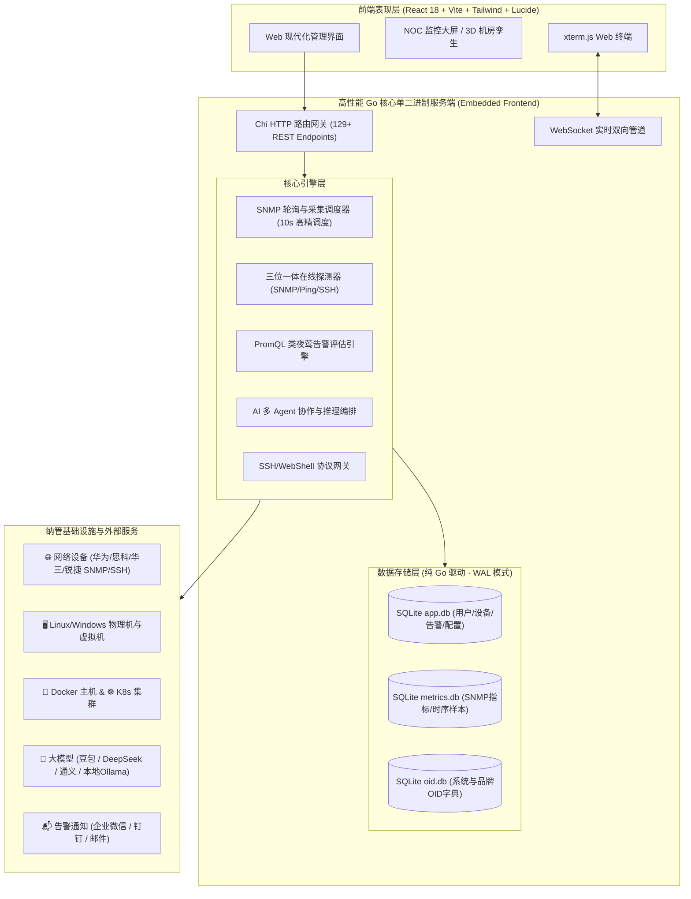

<div align="center">

# ⚡ NetMon Agent Platform
### 基于 AI 多 Agent 协作的企业级全栈智能运维与网络基础设施自动化平台

[](https://golang.org)
[](https://react.dev)
[](https://www.typescriptlang.org/)
[](https://modernc.org/sqlite)
[](LICENSE)
[-orange.svg?style=flat-square)](#-三-系统启动与部署方式)

**国产自研开源 · 告警聚合降噪 · 根因诊断 (RCA) · 故障自愈闭环 · 网络设备 SNMP 监控 · 容器/K8s/虚机统一纳管 · 单二进制零依赖交付**

</div>

---

## 📑 目录
- [一、 系统功能详细介绍](#一-系统功能详细介绍)
  - [1. AI 智能运维与多 Agent 自愈闭环](#1-ai-智能运维与多-agent-自愈闭环)
  - [2. 网络设备与 SNMP 深度监控](#2-网络设备与-snmp-深度监控)
  - [3. 类夜莺 PromQL 告警与策略中心](#3-类夜莺-promql-告警与策略中心)
  - [4. 服务器与容器/云原生统一管理](#4-服务器与容器云原生统一管理)
  - [5. 高兼容 WebShell 终端与安全审计](#5-高兼容-webshell-终端与安全审计)
  - [6. IPAM 子网规划与 3D 机房数字孪生](#6-ipam-子网规划与-3d-机房数字孪生)
  - [7. IDC 上架规划与布线（吸收 IDCBoxLine）](#7-idc-上架规划与布线吸收-idcboxline)
- [二、 技术架构与技术栈](#二-技术架构与技术栈)
  - [1. 总体架构拓扑图](#1-总体架构拓扑图)
  - [2. 核心技术栈清单](#2-核心技术栈清单)
  - [3. 关键架构设计亮点](#3-关键架构设计亮点)
- [三、 系统启动与部署方式](#三-系统启动与部署方式)
  - [1. 方式一：单二进制独立运行（极简·推荐）](#1-方式一单二进制独立运行极简推荐)
  - [2. 方式二：Linux Systemd 系统服务部署](#2-方式二linux-systemd-系统服务部署)
  - [3. 方式三：源码一键全自动交叉编译](#3-方式三源码一键全自动交叉编译)
  - [4. 方式四：本地前后端联合开发模式](#4-方式四本地前后端联合开发模式)
  - [5. 方式五：Docker Compose 一键运行](#5-方式五docker-compose-一键运行)
- [四、 环境变量与配置说明](#四-环境变量与配置说明)
- [五、 开源许可证](#五-开源许可证)

---

## 一、 系统功能详细介绍

### 1. AI 智能运维与多 Agent 自愈闭环
- **12 个专业化 AIOps Agent 分工协作**：
  - **告警降噪 Agent**：智能聚类海量报警事件，抑制告警风暴，提取核心事件链。
  - **根因分析 Agent (RCA)**：结合时序指标、系统日志与网络拓扑，给出自然语言根因诊断报告与置信度。
  - **自愈决策 Agent**：自动生成结构化排障/修复 Shell 命令，评估操作风险等级（低/中/高/高危）。
  - **巡检与日志 Agent**：按计划巡检系统健康度，自动解析过滤异常日志。
  - **合规审计与 DBA Agent**：慢查询分析、配置漂移比对、合规基线扫描。
- **HITL 人机协同移动端审批 (Human-in-the-Loop)**：
  - 高风险或敏感变更支持推送**企业微信、钉钉**，运维工程师在手机端一键确认后由 Agent 自动执行。
- **自愈全流程闭环验证**：
  - 执行命令后自动发起二次探活与指标回采，验证故障是否真正恢复，并自动生成 Post-Mortem 复盘报告。
- **RAG 向量智能知识库**：
  - 内置专家运维经验库，支持本地上传 SOP 文档，语义检索注入大模型上下文，越用越聪明。
- **多模型混合路由与熔断降级**：
  - 原生支持**火山引擎豆包 (Doubao)、DeepSeek、阿里通义千问 (Qwen)、智谱 GLM、OpenAI**。
  - 100% 支持本地私有化大模型（**Ollama / vLLM / LM Studio**），实现敏感数据与拓扑不出内网。

---

### 2. 网络设备与 SNMP 深度监控
- **全厂商 SNMP 适配引擎**：
  - 支持 SNMP v1 / v2c / v3，内置华为 (Huawei)、思科 (Cisco)、华三 (H3C)、锐捷 (Ruijie)、中兴 (ZTE)、飞塔 (Fortinet) 等品牌专属 OID 指标集。
- **自定义 OID 探测与在线下发**：
  - 支持在 Web 界面对任意目标设备进行 **标量 (SNMP GET)** 与 **表量 (SNMP WALK)** 的一键在线测试。
  - 探测成功后**强制要求输入自定义 Tag 标签**（如 `env="prod"`, `role="core-switch"`），一键持久化为该设备的自定义监控采集项。
- **网络 NOC 监控大屏 (100% 真实数据计算)**：
  - **实时总体吞吐速率**：基于精确滑动窗口（`Ranked CTE`）计算端口瞬时上行/下行速率 (Mb/s)，杜绝多设备时间戳毫秒误差导致的速率暴增。
  - **累计吞吐总量**：精确汇总真实入/出方向累计流量 (Gb)。
  - **接口健康全景**：接口 UP/DOWN 实时占比统计、物理错包率/丢包率。
  - **Top 排行与厂商分布**：核心交换机流量 Top 排行榜与设备品牌分布占比。
- **三位一体在线状态监测 (SNMP 优先可达保证)**：
  - 探测器优先验证 SNMP 协议可用性，**只要 SNMP 响应即绝对判定为在线**；辅以 ICMP Ping 与 SSH 端口探测，彻底根除交换机禁 Ping 导致的离线误报。

---

### 3. 类夜莺 PromQL 告警与策略中心
- **内置 PromQL 告警规则评估引擎**：
  - 后端调度器以 10s 粒度实时对时序采样与 Tag 标签执行 PromQL 语法评估。
  - 支持用户自定义输入 PromQL 表达式，如：
    ```promql
    # 核心交换机错误包告警
    snmp_interface_in_errors{role="core-switch", oper_status="up"} > 100
    
    # 华为设备 CPU 占用过高
    huawei_cpu_usage{env="production"} > 85
    ```
- **告警静默、抑制与升级**：
  
  - 支持按 Tag 标签设置维护期静默规则与告警升级策略，避免重复告警轰炸。

---

### 4. 服务器与容器/云原生统一管理
- **Docker 容器全景纳管**：
  - 多主机 Docker 实例统一纳管，容器秒级启停、重启、销毁。
  - 容器实时 CPU/内存/网络/磁盘 IO 监控波形图，流式日志实时查看。
  - 可视化 **Docker Compose** 模板在线编写、部署与编排。
- **Kubernetes 集群纳管**：
  - 支持一键导入标准 `kubeconfig`，可视化查看 Node 资源利用率、Pod 运行状态、Deployments 与 Services 拓扑。
- **多平台虚拟机管理**：
  - 支持对 VMware vSphere、Proxmox VE、KVM 虚拟机进行统一纳管、电源操作与快照回滚。

---

### 5. 高兼容 WebShell 终端与安全审计
- **全功能交互式 WebShell**：
  - 基于 xterm.js + WebSocket，支持多标签页、窗口尺寸动态自适应、快捷命令面板。
- **老旧网络设备专用算法兼容**：
  - 针对老旧核心交换机/防火墙，原生集成 `diffie-hellman-group-exchange-sha1`、`diffie-hellman-group14-sha1` 及 `ssh-rsa` 密钥交换算法，杜绝握手失败。
- **高危命令安全过滤引擎**：
  - 内置 7 类高危指令拦截机制（如 `rm -rf /`、`mkfs`、`dd`、`iptables -F` 等），支持按角色授权与全操作审计留痕。

---

### 6. IPAM 子网规划与 3D 机房数字孪生
- **IP 地址资产管理 (IPAM)**：
  - IP 子网与 VLAN 统一规划，自动生成可用地址池，支持 IP 分配、预留、回收与使用率热力图。
- **机房 3D 数字孪生**：
  - 基于 WebGL / Three.js 渲染机房 3D 空间，支持机柜机位 U 位展示、设备上下架状态与功耗/温湿度联动。

---

### 7. IDC 上架规划与布线（吸收 IDCBoxLine）

> 原独立项目 **IDCBoxLine** 已整体并入本仓库 `planning/`：域层、Web、数据、规则、黄金向量与文档全部保留，
> 由 NetMon 统一托管、鉴权与交付。入口：侧边栏「数据机房 → IDC上架布线」(`/planning`)。

- **十二个工作台**：平面与机柜（2D 拖拽调 U 位）、接线设计（意图 → 布线表）、布线表、数据体检、
  端口与策略、耗材清单、项目与版本、版本对比、设备台账、设备型号库、线缆标签、3D 机房。
- **线长七公式引擎**：`N/O/P/Q/R/S/T` 从客户 5127 行 Excel 反解，导出 24 列 × 5127 行**逐格 diff = 0**；
  端口分配规律 3850/3850 复现。公式唯一实现保留在 Python 域层，前端镜像共享同一份 golden vectors。
- **数据体检**：自动检出几何填错、U 位重叠、缺几何量、IFS 档位多买等问题，输出评分与明细。
- **项目版本库**：意图存为版本，支持比较与回退；SQLite 项目库随包提供种子数据（V13 / 信息港二期）。
- **架构（为何不是 Go 重写）**：域层 25k 行 Python 已由 1328 个用例与逐格导出铁线验证，重写会同时丢掉
  公式口径与回归证据。因此 Go 主服务内置 `internal/modules/planning`：
  1. **进程监管**：自动发现 `planning/`，启动/健康检查/失败退避重启/优雅关停；
  2. **认证反向代理**：`/api/v1/planning/*` 走 NetMon JWT，引擎只监听 `127.0.0.1`；
  3. **静态内嵌**：规划前端构建产物 `//go:embed`，与主前端一起随单二进制分发（Docker 内置 Python 运行时）。
- **独立开发**：

```bash
cd planning/backend
python3.12 -m venv .venv
.venv/bin/pip install -e ".[infra,api]"
cd ../web && pnpm install && pnpm dev   # 可选：规划前端热更新，API 代理到 18001
```

  之后正常启动 Go 服务即可；引擎未就绪时页面会给出原因与修复提示，主平台其余功能不受影响。
- **离线绿色包**：`planning/scripts/package_green.sh` 可产出含独立 Python 运行时的引擎包；
  解压后用 `PLANNING_ROOT=/path/to/IDCBoxLine-*-offline` 指向它，Go 会自动使用 `runtime/` + `vendor/`。

---

## 二、 技术架构与技术栈

### 1. 总体架构拓扑图



---

### 2. 核心技术栈清单

| 层次 | 核心技术 | 选型优势说明 |
| :--- | :--- | :--- |
| **后端语言** | **Go 1.25** | 高并发、超低内存占用、天然支持跨平台交叉编译 |
| **HTTP 路由** | **Chi Router v5** | 极简快速、轻量级、完全符合 Go 标准库 `net/http` 接口 |
| **数据存储** | **Pure-Go SQLite (`modernc.org/sqlite`)** | **无需 CGO/GCC**，零外部数据库依赖，WAL 高并发模式，自动完成 60+ 次 Schema 迁移 |
| **SNMP 协议** | **Gosnmp v1.44** | 高性能纯 Go SNMP 实现，支持 v1/v2c/v3 报文编解码 |
| **终端引擎** | **xterm.js + Gorilla WebSocket** | 毫秒级低延迟 WebShell，全面支持 ANSI 颜色与流控 |
| **前端框架** | **React 18 + TypeScript 5.7** | 现代化组件化架构，类型安全，极致开发体验 |
| **构建工具** | **Vite 5** | 毫秒级热更新，Rollup 生产打包优化 |
| **可视化图表** | **ECharts + Three.js + Lucide Icons** | 丰富的时序波形图、网络拓扑图与 3D WebGL 数字孪生机房 |
| **规划引擎** | **Python 3.12 + FastAPI + SQLAlchemy** | 上架布线域层经 1328 用例与逐格导出铁线验证；由 Go 监管并反向代理，保留验证资产 |

---

### 3. 关键架构设计亮点

1. **内嵌式一体化交付 (`//go:embed`)**：
   - 前端 Vite 产物（HTML、CSS、JS、字体与图标）全量内嵌至 Go 二进制中。
   - 用户**无需在宿主机上安装 Node.js、NPM、Python 或 Nginx**，直接分发运行单个文件即可。
   - IDC 上架布线模块的前端同样内嵌；其 Python 引擎由 Docker 镜像内置，或在独立二进制旁放置
     `planning/`（含 venv / 绿色包运行时）后自动发现，可用 `PLANNING_ROOT` 显式指定。
2. **纯 Go 零 CGO 编译 (`CGO_ENABLED=0`)**：
   - 彻底摆脱 GCC/MinGW 跨平台交叉编译限制，可在 Windows 上秒级构建出标准的 Linux x86_64 与 ARM64 生产包。
3. **分库与分区滑动窗口算法**：
   - 业务配置库（`app.db`）与高频时序指标库（`metrics.db`）物理隔离，互不阻塞。
   - 网络流量采用 `ROW_NUMBER() OVER (PARTITION BY device_id, if_index)` 精确计算接口前后两点差值与耗时，从算法底层消除跨设备时间差导致的速率异常。

---

## 三、 系统启动与部署方式

### 1. 方式一：单二进制独立运行（极简·推荐）

编译好的跨平台二进制产物位于 [`backend-go/release/`](./backend-go/release/) 目录：

#### 🪟 Windows 运行：
```powershell
# 进入 release 目录
cd backend-go\release

# 直接双击或命令行启动（默认监听 8088 端口）
.\itops-server-windows-amd64.exe

# 启动后在浏览器打开：
http://localhost:8088
```

#### 🐧 Linux (x86_64 / ARM64) 运行：
```bash
# 赋予可执行权限
chmod +x itops-server-linux-amd64

# 前台测试运行
./itops-server-linux-amd64

# 后台持续运行（推荐）
nohup ./itops-server-linux-amd64 > itops.log 2>&1 &
```

> 🔑 **默认初始账号**：`admin`  
> 🔑 **默认初始密码**：`Admin@2026`（首次登录后系统会强制提示修改安全密码）

---

### 2. 方式二：Linux Systemd 系统服务部署

创建服务文件 `/etc/systemd/system/itops.service`：
```ini
[Unit]
Description=ITOps Agent Platform
After=network.target

[Service]
Type=simple
User=root
WorkingDirectory=/opt/itops
ExecStart=/opt/itops/itops-server-linux-amd64
Restart=always
RestartSec=5
LimitNOFILE=65536

[Install]
WantedBy=multi-user.target
```

加载并启动服务：
```bash
systemctl daemon-reload
systemctl enable itops
systemctl start itops
systemctl status itops
```

---

### 3. 方式三：源码一键全自动交叉编译

项目根目录提供了全自动的一键构建脚本（全自动构建前端 Vite 产物、同步至嵌入目录并交叉编译 Windows/Linux 三平台二进制）：

- **Windows 用户**：直接双击运行根目录下的 [`build_release.bat`](./build_release.bat)
- **Linux/macOS 用户**：
  ```bash
  chmod +x ./build_release.sh
  ./build_release.sh
  ```

---

### 4. 方式四：本地前后端联合开发模式

若需对系统进行二次开发或定制：

#### 1. 启动 Go 后端服务：
```bash
cd backend-go
go run ./cmd/server
# 后端 API 将监听在 http://localhost:8088
```

#### 2. 启动前端 Vite 开发服务器：
```bash
cd frontend
npm install
npm run dev
# 前端服务将启动在 http://localhost:3000 (已配置好接口反向代理)
```

### 5. 方式五：Docker Compose 一键运行

镜像为三阶段构建：Node 编译前端 → Go 内嵌前端产物并编译单二进制 → Alpine 精简运行时。

```bash
# 构建并后台启动（首次构建需拉取依赖，约 3-6 分钟）
docker compose up -d --build

# 查看状态与日志
docker compose ps
docker compose logs -f itops

# 停止（数据保留在命名卷中）
docker compose down

# 停止并清空数据库
docker compose down -v
```

访问 `http://localhost:8088`（可用 `ITOP_PORT` 覆盖宿主机端口）。
数据库、上传文件与日志分别持久化在 `itops-data`、`itops-logs` 命名卷中。
Compose 项目名固定为 `most_agent`（见 `name:` 字段），即使仓库目录改名也继续复用原有 `most_agent_itops-data` / `most_agent_itops-logs` 卷；如需迁移到新卷，先备份 `/app/data` 再执行 `docker compose down -v`。
生产部署必须显式设置 `JWT_SECRET`（≥32 字符，`openssl rand -hex 32`）；建议同时设置 `ENCRYPTION_KEY` 用于凭据加密。
首次启动（users 表为空）会生成随机 admin 口令并写入 `<数据库目录>/initial-admin-password.txt`（0600），日志只打印该路径，登录后需立即修改。


---

## 四、 环境变量与配置说明

系统支持通过项目根目录的 `.env` 文件或系统环境变量进行个性化配置（均包含开箱即用的默认值）：

```ini
# 基础服务配置
PORT=8088                         # 服务监听端口 (默认: 8088)
DATABASE_PATH=./data/app.db       # SQLite 数据库文件 (默认: backend/data/app.db)
LOG_LEVEL=info                    # 日志级别: debug / info / warn / error

# IDC 上架规划与布线引擎（原 IDCBoxLine）
PLANNING_ENABLED=true             # 关闭后 /api/v1/planning 返回 503，其余功能不受影响
PLANNING_ROOT=                    # 引擎根目录；留空自动查找 ./planning 或二进制同级
PLANNING_PYTHON=                  # 指定解释器；留空自动找 venv / 绿色包 / python3
PLANNING_PORT=18001               # 引擎本地端口（仅 127.0.0.1）
PLANNING_DB=                      # 项目版本库；留空用 <ROOT>/data/idcbox.db，缺失时播种

# 安全与认证配置
JWT_SECRET=                       # 生产必填，>=32 字符；开发留空则自动生成
JWT_EXPIRES_IN=24h                # Access Token 有效期
ENCRYPTION_KEY=                   # 凭据加密密钥，>=32 字符；留空回退 JWT_SECRET
ALLOWED_ORIGINS=http://localhost:3000,http://localhost:8088  # CORS 白名单
TRUSTED_PROXIES=                  # 可信反代 IP/CIDR，命中后才信任 X-Forwarded-For
AUTH_DEV_BYPASS=false             # 仅开发环境：跳过认证（生产强制忽略）

# AI 模型配置 (也可在登录后在前端 "设置 → AI 配置" 界面可视化设置)
DOUBAO_API_KEY=your-api-key       # 火山引擎豆包 API Key
OPENAI_API_KEY=your-api-key       # OpenAI 兼容 API Key
OPENAI_API_BASE=https://api.openai.com/v1
```

---

## 五、 开源许可证

本项目遵循 [Mozilla Public License 2.0 (MPL-2.0)](LICENSE) 开源授权协议：
- 允许企业内网免费商用、私有化部署与二次改造。
- 若对外分发基于本项目的修改版本，所修改的源文件必须保持开源并保留原始版权信息。

---

<div align="center">
  <sub>⚡ ITOps Agent Platform · 让运维更简单，让系统更有序</sub>
</div>
