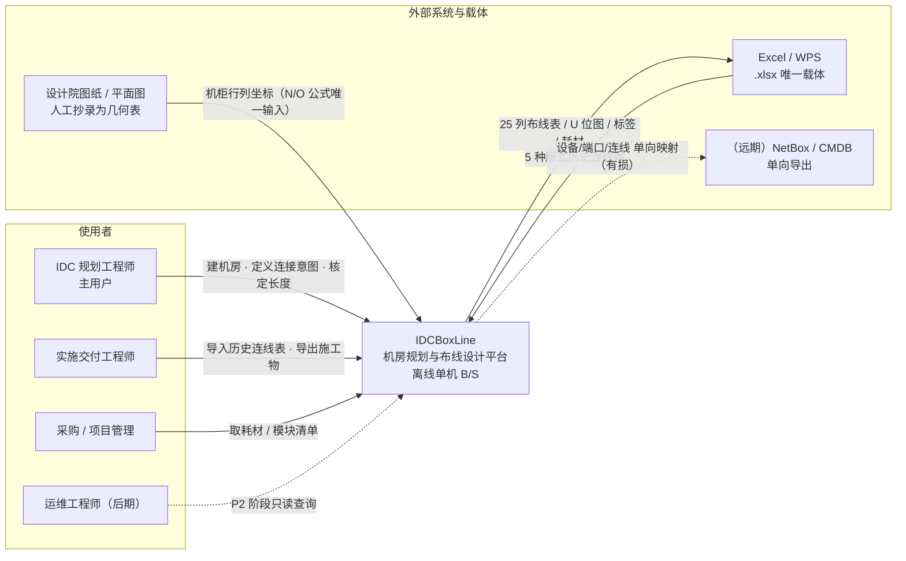
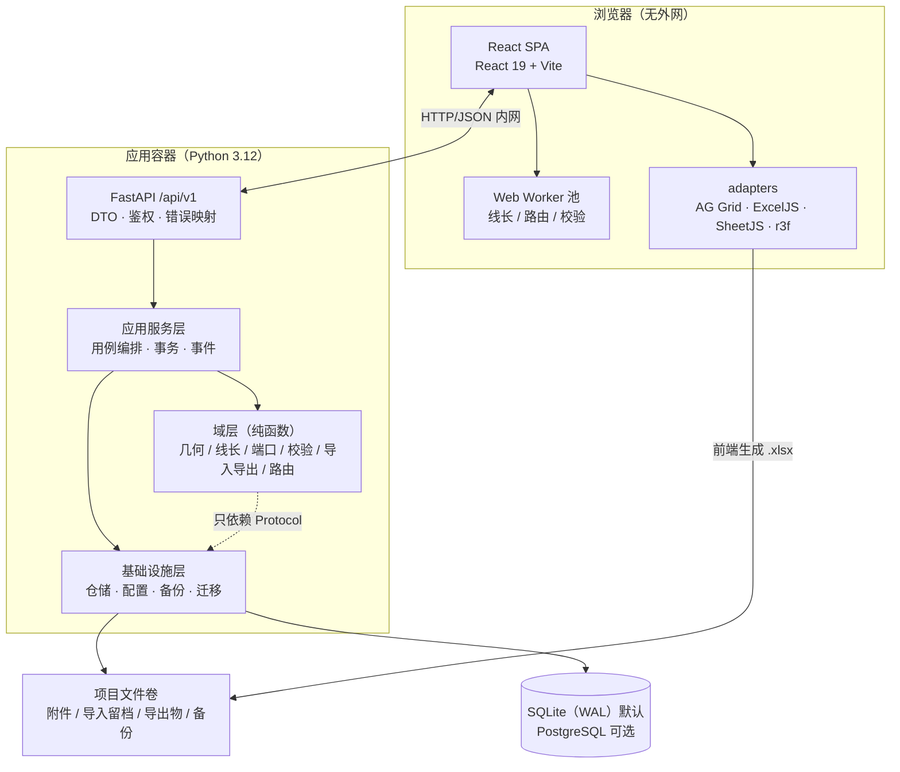
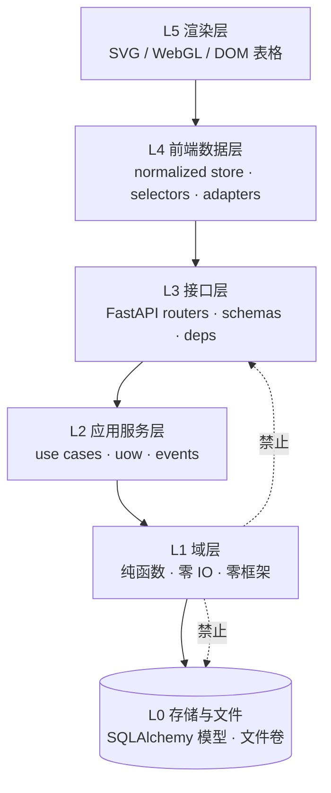
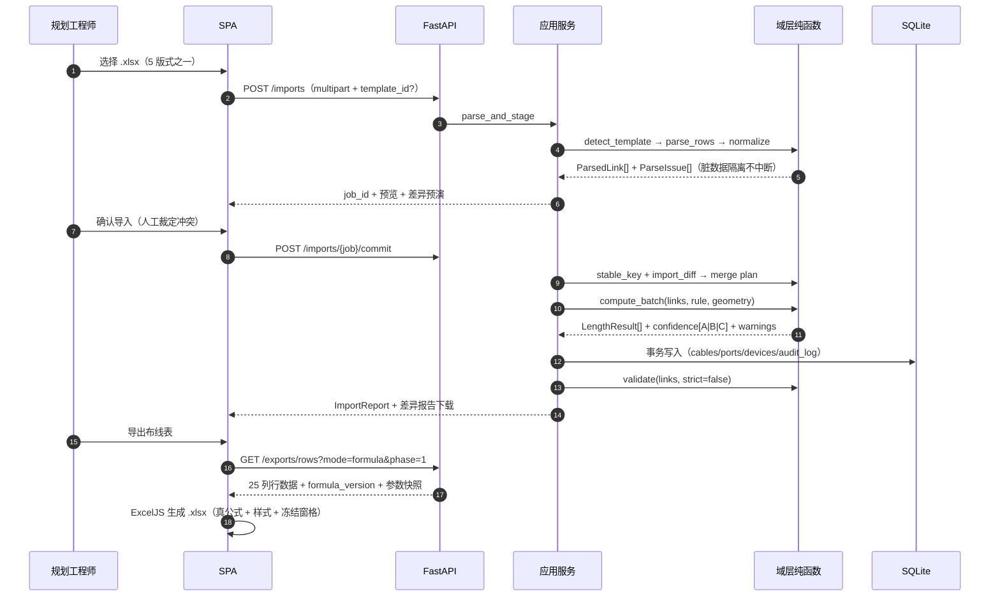
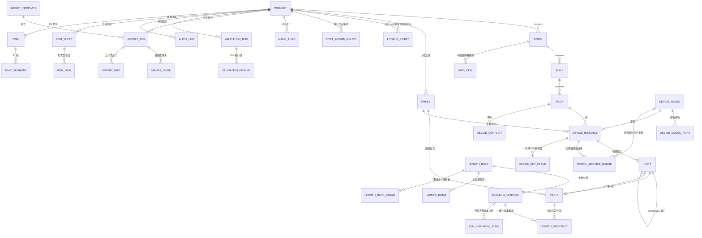
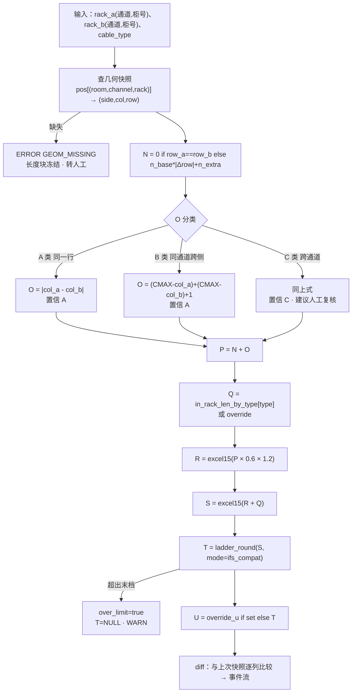
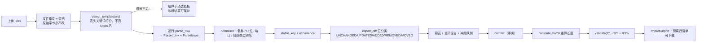
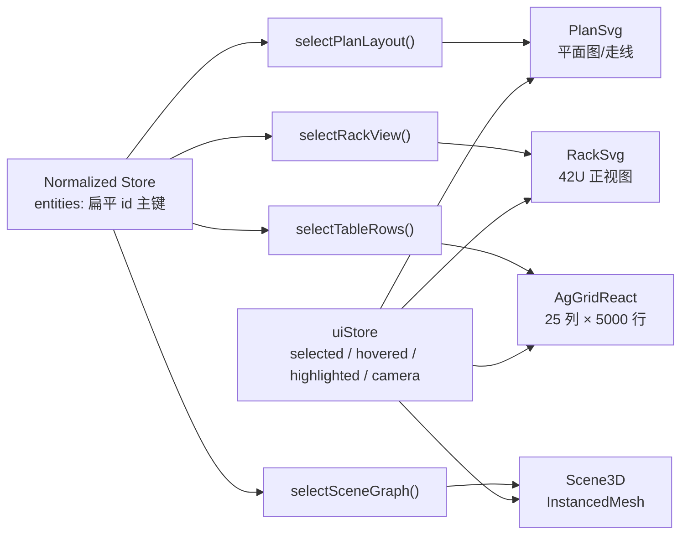

# 02 — 系统架构设计
> 版本：v1.0　编写日期：2026-10-21　状态：评审稿
> 上游输入：`docs/architecture/00-源数据实测基线.md`、`docs/architecture/01-线长算法反解报告.md`、`docs/requirements/01-需求规格说明书.md`、`docs/research/01~04`
> 下游消费：实现计划、接口联调、验收测试、部署交付
> **本文档不含产品代码**。所有物理与业务公式的唯一来源是 01 号文档；本文只回答「如何承载公式」，不回答「公式应改成什么」。对公式的异议集中列在 §4.12。
> 数字口径一句话：**824 个物理位置、10203 个端口、5113 条连线、636 行长度块、362 个规划机柜位**（全部取自 00 号基线，可脚本复现）。
## 1. 架构总览
### 1.1 一句话架构
一个**完全离线、单机、一条命令启动的 B/S 应用**：Python 域层用纯函数承载「机房几何 + 线长公式 + 校验规则」，FastAPI 暴露 REST，React SPA 把**同一份规范化数据**投影成三种视图（2D SVG / 3D WebGL / 表格 DOM）。Excel 是唯一进出口且必须位级保真。域层不认识 HTTP，渲染层不认识业务真相。
### 1.2 五条硬约束（架构的因，不是背景）
| # | 约束 | 来源 | 架构后果（决定下文哪些设计不能省） |
|---|---|---|---|
| C-1 | 完全离线、单机、一条命令部署 | NFR-3/AC-8/FR-9.4 | 无云服务、无运行时 CDN；依赖全部本地化（含 SheetJS tarball）；无 license server |
| C-2 | 线长公式已被真实数据验证定论，不得改动 | 01 号全文 + 用户要求 | 公式进域层纯函数；参数 100% 外置；版本号冻结；golden test 用 636 行真实数据回归 |
| C-3 | Excel 是唯一交付载体，导出列契约一致 | AC-1/AC-3/FR-5.1/NFR-5 | 导入「模板 DSL」驱动；导出「公式/值」双模式；浮点按 Excel 15 位有效数字口径 |
| C-4 | 5000 连线重算 <3s、表格 60fps、3D ≥30fps | NFR-1/2、AC-6/7 | 计算与路由进 Worker 与后端并行；三个渲染后端均为无状态投影 |
| C-5 | 源数据无自然主键、14 类缺陷、13 对 U 位重叠 | 00 号 §7 / 03 号 §9A | 三段式稳定键 + 三路 diff；约束「软强制」（冲突入人工队列）；别名表三 scope |
### 1.3 八条架构原则
1. **公式是一等公民**：`N/O/P/Q/R/S/T` 只存在于 `domain/cable_length/formulas.py`，其它位置出现同名计算即违规（CI 拦截）。
2. **几何层与经验层分离**：几何层（N/O/P/R/S/T）确定性、可 100% 复现、偏差即报错、责任在系统；经验层（Q 例外、U 核定）概率性、必须留痕、责任在设计师。
3. **一份数据，三个渲染后端**：业务真相只在 Normalized Store；`render(state)` 是纯函数；交互一律 `dispatch(action)`。
4. **第三方库只经 adapter**：AG Grid / ExcelJS / SheetJS / three.js 各自只有一个 adapter 文件。
5. **配置优于代码**：`0.6 / 1.2 / 档位表 / CMAX / 机架槽位` 全部来自配置与 DB，改规则不改代码（NFR-8）。
6. **幂等是一等公民**：导入、导出、重算可重复执行且结果稳定。
7. **审计先行**：任何人工覆盖（U、线缆类型、冲突裁定）写 `audit_log` + 原值 + 原因 + 公式版本。
8. **诚实标注**：无桥架数据就说无桥架（Level 1 经验公式），不宣称未达成的精度（N/O 只宣称 98.6% / 91.8%）。
### 1.4 C4 上下文视图

### 1.5 C4 容器视图

> 关键取舍：**Excel 生成在前端**（ExcelJS 复用域层给出的行数据并直接下载），后端只提供 `/exports/rows` 的规范化数据与契约版本。导入解析在后端（openpyxl 主、SheetJS 兜底）。见 ADR-014。
### 1.6 分层与依赖方向

| 层 | 允许 | 禁止 | 强制手段 |
|---|---|---|---|
| L1 域层 | 标准库、`decimal`、`dataclasses`、`typing`、`enum` | fastapi / sqlalchemy / pydantic / openpyxl / 任何 IO | `import-linter` 合同 + CI 阻断 |
| L2 应用层 | L1、Protocol 抽象、事务抽象 | 直接写 SQL、碰 HTTP 请求对象 | 仓储只暴露域对象 |
| L3 接口层 | L2、L1、pydantic v2、fastapi | 直接调 L0 | 只经服务/仓储 |
| L4 前端数据层 | API 客户端、域镜像纯函数 | React 组件 | ESLint `no-restricted-imports` |
| L5 渲染层 | L4 的 store / selector | 直接 fetch、直接算公式 | 同左 |
### 1.7 关键数据流

### 1.8 技术栈定版（采纳 research 02，不再论证）
| 部位 | 选型 | 版本 | 许可 | 角色 |
|---|---|---|---|---|
| 前端 | React + TypeScript + Vite | 19.3.x / 5.x | MIT | 唯一 UI 运行时 |
| 2D | 纯 SVG 自绘 | — | — | 平面图 / U 位图 / 走线；可 `XMLSerializer` 直出 |
| 3D | three.js + @react-three/fiber + InstancedMesh | 0.186.1 / 9.8.2 | MIT | P1；200 柜 + 3000 设备 ≥30fps |
| 表格 | AG Grid Community | 36.2.0 | MIT | 25 列 × 5000 行 + 自研 Excel 化交互层 |
| 公式列 | 自研 `valueGetter` → 域函数 | — | — | 公式活在域层，不活在控件配置（ADR-011） |
| 状态 | zustand + immer | 5.0.15 / 11.1.21 | MIT | normalized store 与 uiStore 分离 |
| Excel 写 | ExcelJS | **4.4.0 精确锁** | MIT | 真公式 / 样式 / 冻结窗格 |
| Excel 读 | SheetJS CE | 0.20.3 CDN tgz | Apache-2.0 | 仅兜底解析；**禁用 npm `xlsx@0.18.5`** |
| 后端 | Python + FastAPI | 3.12 / 0.11x | MIT | REST + OpenAPI |
| ORM / 校验 | SQLAlchemy 2.0 / Pydantic v2 | 2.0.x / 2.x | MIT | 仓储实现 / 边界校验 |
| 数据库 | SQLite（WAL）默认，PostgreSQL 可选 | 3.4x / 16 | Public / PostgreSQL | 单机零运维 |
| 部署 | Docker Compose + 单容器兜底 | — | — | 一条命令（§9） |
### 1.9 与其它文档的边界
| 文档 | 本文如何使用 | 边界 |
|---|---|---|
| 00 号 源数据实测基线 | 全部规模数字、缺陷清单、口径 | 发现新数字先改 00 号，本文只引用 |
| 01 号 线长算法反解报告 | **公式唯一来源**，逐字承载（§4.3） | 公式一字不改；异议进 §4.12 |
| 需求规格说明书 | FR/NFR/AC → 架构部件映射（§10.4 AC→测试映射） | 不改需求优先级 |
| research 02 | 直接采纳（§1.8、§8） | 不重新论证选型 |
| research 03 | 29 条规则、端口分配、导入导出契约、9A 幂等 | 不重写规则语义 |
| research 01 | 决定「自研核心 + NetBox 当参考系」（ADR-001） | 不引入 NetBox 运行时 |
## 2. 代码分层与目录结构
### 2.1 三条硬规矩
1. **域层零 IO**：`domain/` 任何文件不得 import 数据库/HTTP/文件系统/Excel 库；输入输出全是 dataclass。5127 行全量重算因此可在 pytest 里毫秒级跑千次。
2. **公式单点**：`domain/cable_length/formulas.py` 是 `N/O/P/Q/R/S/T` 唯一实现；前端镜像 `web/src/domain/cableLength.ts` 必须通过同一份 golden vectors（§10.2）才允许合入。
3. **适配器收口**：`infrastructure/` 与 `web/src/adapters/` 是唯一允许出现第三方库类型的地方。
### 2.2 目录树
```
IDCBoxLine/
├── backend/                       # Python 3.12 + FastAPI；pyproject.toml 锁依赖
│   ├── migrations/versions/       # alembic，双 dialect（SQLite / PG）
│   ├── config/                    # default.rule.yaml（= 01 号参数逐字）
│   │   ├── schema/                # cable_length_rule / formula_version / import_template / export_contract_25col (.v1.schema.json)
│   │   └── templates/             # 5 种导入版式：v13_25col v11_17col v8v9_13col cold_aisle_dbl_24col gov_extranet_9col
│   ├── idcbox/
│   │   ├── domain/                # ★ L1 纯函数，无框架无 IO，毫秒级可跑千次
│   │   │   ├── units.py           # 几何常量中心（★ 不含 0.72）
│   │   │   ├── geometry/          # floor.py layout.py grid.py
│   │   │   ├── cable_length/      # ★ 公式唯一实现处（文件职责见下表）
│   │   │   ├── ports/             # naming.py cable_type.py phase.py pool.py assign.py
│   │   │   ├── intent/            # 网卡口 → 网络平面 → 设备角色；module_lookup.py
│   │   │   ├── validation/        # rules.py(C1..C29+R30) severity.py report.py
│   │   │   ├── importing/         # normalize.py stable_key.py diff.py template.py
│   │   │   ├── exporting/         # contract25.py formula_text.py consumables.py
│   │   │   ├── routing/           # P1 桥架 Level 2；无数据降级 Level 1
│   │   │   └── shared/            # 值对象 Id / Result / Issue / Enum
│   │   ├── application/           # L2 用例编排
│   │   │   ├── services/          # project layout device cable length import export validation consumable
│   │   │   └── ports.py uow.py events.py   # 仓储/时钟/ID Protocol、Unit of Work、领域事件
│   │   ├── infrastructure/        # L0 实现（第三方库只许出现在这里）
│   │   │   ├── db/                # models.py session.py repositories/
│   │   │   ├── xlsx/              # openpyxl_reader.py sheetjs_bridge.py layout_parser.py
│   │   │   ├── config/ fs/storage.py   # loader.py override.py；卷布局·原子写·导出留档
│   │   │   └── backup.py          # SQLite VACUUM INTO + 定时
│   │   ├── api/                   # L3：main.py deps.py errors.py + schemas/ + routers/
│   │   └── cli.py                 # initdb / seed / import / export / calibrate
│   └── tests/                     # unit/domain · golden/（下表）· integration/（幂等 5 用例）· perf/（<3s、增量<200ms）
├── web/src/                       # React 19 + TS + Vite；exceljs 精确 4.4.0、xlsx 走 tgz
│   ├── domain/                    # ★ 只读镜像，不得成为第二真值：units.ts cableLength.ts geometry.ts validation.ts
│   ├── store/ adapters/           # entities.ts uiStore.ts selectors/；agGrid.ts exceljs.ts sheetjs.ts three.ts
│   ├── workers/                   # length.worker.ts route.worker.ts validate.worker.ts
│   └── views/ components/ api/    # plan rack cables scene3d imports exports consumables settings admin；client.ts types.gen.ts
├── shared/golden/                 # 前后端共用向量：length_vectors.json（200 条 A/B/C+边界）ladder_vectors.json
├── deploy/                        # docker-compose.yml Dockerfile.backend Dockerfile.web nginx.conf
│   ├── vendor/xlsx-0.20.3.tgz     # ★ 离线必需（NFR-3）
│   └── offline-bundle/            # 镜像 tar + wheel + npm 缓存
├── docs/                          # 00/01/02/03 号文档与 research
└── scripts/                       # 反解脚本（.scratch 的正式化版本）
```


`domain/cable_length/` 逐文件职责（★ 公式"只活一次"的物理落点）：

| 文件 | 职责 | 关键符号 |
|---|---|---|
| `formulas.py` | `N/O/P/Q/R/S/T` 唯一实现，一一对应七个列 | `n_cross_rack` `o_gap_rack` `p_rack_count` `q_in_rack` `r_inter_rack` `s_total` `t_ladder` |
| `policy.py` | 四策略统一入口（§4.7A） | `LengthPolicy` `compute_all_policies` `resolve_length` |
| `empirical.py` | 经验表查询 + LOO 自检 | `EmpiricalTable` `candidate_empirical` |
| `ladder.py` | IFS 有序规则表 / 连续模式 | `Rung` `IFS_COMPAT` `CONTINUOUS` `ladder_round` |
| `numeric.py` | Excel 15 位有效数字口径 | `excel15` |
| `rules.py` | 参数对象与校验 | `LengthRule` `RackPos` `GeometrySnapshot` |
| `confidence.py` | A/B/C 分层与置信度门控 | `OClass` `gate_confidence` |
| `version.py` | 公式版本号与内容哈希 | `FORMULA_V1` `content_hash` `FORMULA_IMPL_HASH` |
| `engine.py` | 编排（仍是纯函数） | `compute_link` `compute_batch` `compute_incremental` |
| `diff.py` | 重算差异事件 | `diff_snapshots` `LengthChange` |

`tests/golden/` 内容（**用真实 5127 行数据回归的物理落点**）：`data/v13_cabling_fixture.xlsx` 真实文件（含 636 行长度块）；`baseline/length_block_636.json` N/O/P/Q/R/S/T/U 逐行期望；`baseline/empirical_loo.json` 5104 行 LOO ≥87.11%；`baseline/ladder_vectors.json` S→T 边界（含 `(6,7)` 空隙）；`baseline/float_vectors.json` 15 位向量；`test_golden_{length,empirical,ladder,export}.py` 四个用例。
### 2.3 前端目录边界
| 目录 | 允许 | 禁止 |
|---|---|---|
| `src/domain/` | 纯函数、常量、golden 消费 | React / fetch / DOM |
| `src/store/` | zustand slice、纯 selector | 发请求、算公式 |
| `src/adapters/` | 第三方库实例化与类型转换 | 业务判断 |
| `src/views/` | 渲染 + 事件绑定 | 数据加工、二次计算 |
### 2.4 依赖倒置清单（域层只能看到这些 Protocol）
```python
# application/ports.py —— 无实现，只有契约
class Clock(Protocol):
    def now(self) -> datetime: ...
class IdGenerator(Protocol):
    def new_id(self, prefix: str) -> str: ...
class GeometryRepository(Protocol):
    def snapshot(self, project_id: str) -> GeometrySnapshot: ...
class RuleRepository(Protocol):
    def active_rule(self, project_id: str) -> LengthRule: ...
class CableRepository(Protocol):
    def by_ids(self, ids: Sequence[str]) -> list[Cable]: ...
    def upsert_many(self, cables: Sequence[Cable]) -> UpsertStats: ...
class AuditWriter(Protocol):
    def append(self, event: AuditEvent) -> None: ...
```
### 2.5 CI 强制（否则分层一周内腐化）
| 检查 | 工具 | 阻断 |
|---|---|---|
| 域层不得 import 框架/IO | `import-linter` forbidden-contract | 是 |
| 公式单点 | grep `4 *` 类几何式，只允许命中 `formulas.py` | 是 |
| 前后端镜像一致 | `pytest shared/golden` + `vitest shared/golden` | 是 |
| 版本锁定 | `npm ci` 校验 exceljs 精确版本、xlsx 为 tgz | 是 |
| golden 回归 | `pytest tests/golden -x` | 是 |
| 导出位级 diff | `scripts/verify_export.py` 逐格比较 25 列 | 是 |
## 3. 领域模型与数据库设计
### 3.1 五个非直觉决策
| # | 决策 | 依据 |
|---|---|---|
| D-1 | 设备主键用**物理位置** `(rack_id, u_start)`，不用名字 | 824 位置中 631 个服务器实例名为空；196 实例名仅覆盖 203 位置 |
| D-2 | 型号与实例是**两层命名**，实例名承载业务角色 | `业务接入交换机 1` 下挂 `NAT接入交换机-1`/`管理接入交换机-1`/`密评接入交换机-1` |
| D-3 | **`Phase`（批次）是一等实体** | 首期设备 84/824=10.0%、首期耗材 450/5113=8.8%，不是全量视图 |
| D-4 | 线长结果是**快照 + 公式版本**，不是派生视图 | 版本升级要能证明「哪些行变了、为什么变」 |
| D-5 | U 位重叠、端口冲突**不加 DB 唯一约束** | 源数据 13 对重叠，硬约束会让真实文件导入失败 |
### 3.2 ER 图

### 3.3 SQL DDL（SQLite 方言；PG 差异见 §3.6）
```sql
-- 34 张表。DDL 即契约：域层不得绕过仓储直接 SQL；任何表改动必须同步本节 + 迁移脚本。-- ★ = 非直觉设计，改动前先读 §3.1。
-- ============ 0. 项目 / 公式版本 / 线长规则 ============
CREATE TABLE project (
  id TEXT PRIMARY KEY, name TEXT NOT NULL, site_key TEXT NOT NULL,  -- site_key 参与稳定业务键哈希
  status TEXT NOT NULL DEFAULT 'draft' CHECK (status IN ('draft','baselined','archived')), created_at TEXT NOT NULL, updated_at TEXT NOT NULL);
CREATE TABLE formula_version (  -- ★ 公式/规则的一等版本号，使任意历史计算可重放
  id TEXT PRIMARY KEY,  -- 'FV-1.0.0-20261021-9f3c2a'
  semver TEXT NOT NULL, content_hash TEXT NOT NULL UNIQUE,  -- 公式文本 + 参数规范化哈希
  rule_json TEXT NOT NULL,  -- 完整参数快照（离线可重放，不依赖当时配置）
  ladder_mode TEXT NOT NULL DEFAULT 'ifs_compat' CHECK (ladder_mode IN ('ifs_compat','continuous')), status TEXT NOT NULL DEFAULT 'active' CHECK (status IN ('draft','active','frozen','retired')), note TEXT, created_at TEXT NOT NULL, created_by TEXT NOT NULL);
CREATE TABLE length_rule (
  id TEXT PRIMARY KEY, project_id TEXT REFERENCES project(id) ON DELETE CASCADE, name TEXT NOT NULL, rack_spacing_m REAL NOT NULL DEFAULT 0.6, slack_ratio REAL NOT NULL DEFAULT 1.2,  -- 0.6 / 1.2
  n_base INTEGER NOT NULL DEFAULT 4, n_extra INTEGER NOT NULL DEFAULT 4,  -- N = n_base*d + n_extra (d>0)
  cmax_403 INTEGER NOT NULL DEFAULT 38, cmax_404 INTEGER NOT NULL DEFAULT 18,  -- ★ 排端列，O 的 B/C 类必需
  o_cross_aisle_mode TEXT NOT NULL DEFAULT 'rack_end' CHECK (o_cross_aisle_mode IN ('rack_end','manual_only')), allow_auto_q_override INTEGER NOT NULL DEFAULT 1, is_active INTEGER NOT NULL DEFAULT 1, UNIQUE (project_id, name));
CREATE TABLE length_rule_param (  -- 键值扩展位，避免频繁加列
  rule_id TEXT NOT NULL REFERENCES length_rule(id) ON DELETE CASCADE, key TEXT NOT NULL, value_json TEXT NOT NULL, PRIMARY KEY (rule_id, key));
CREATE TABLE ladder_rung (  -- ★ 有序规则表：seq 即语义，禁止排序 / 二分优化
  rule_id TEXT NOT NULL REFERENCES length_rule(id) ON DELETE CASCADE, seq INTEGER NOT NULL, op TEXT NOT NULL CHECK (op IN ('le','eq','lt')), limit_value REAL NOT NULL, out_length INTEGER NOT NULL,  -- 5.0→5 / 6.0→7 / eq 7.0→7 …
  label TEXT, PRIMARY KEY (rule_id, seq));
CREATE TABLE len_empirical_rule (  -- ★ 经验表：(空间类,线缆类型,路径距离) → 长度，LOO 87.11%（§4.1A）
  id TEXT PRIMARY KEY, project_id TEXT REFERENCES project(id) ON DELETE CASCADE,  -- NULL = 内置默认表
  formula_version_id TEXT NOT NULL REFERENCES formula_version(id),  -- ★ 经验表纳入版本哈希，历史快照可重放
  space_class TEXT NOT NULL CHECK (space_class IN ('A','B','C')), cable_type TEXT NOT NULL, path_units INTEGER NOT NULL, length_m INTEGER NOT NULL, sample_n INTEGER NOT NULL, purity REAL NOT NULL,  -- purity 决定置信度门控
  confidence TEXT GENERATED ALWAYS AS (CASE WHEN purity>=0.95 AND sample_n>=10 THEN 'HIGH' WHEN purity>=0.85 THEN 'MEDIUM' ELSE 'LOW' END) VIRTUAL, UNIQUE (project_id, formula_version_id, space_class, cable_type, path_units));
-- ============ 1. 空间与机柜（几何真相，N/O 的唯一输入） ============
CREATE TABLE room (
  id TEXT PRIMARY KEY, project_id TEXT NOT NULL REFERENCES project(id) ON DELETE CASCADE, name TEXT NOT NULL, code TEXT NOT NULL,  -- '403'/'404'
  col_min INTEGER NOT NULL, col_max INTEGER NOT NULL,  -- col_max 即 CMAX
  power_kw_per_rack REAL NOT NULL DEFAULT 4.0, declared_rack_count INTEGER, UNIQUE (project_id, code));
CREATE TABLE aisle (
  id TEXT PRIMARY KEY, room_id TEXT NOT NULL REFERENCES room(id) ON DELETE CASCADE, channel_no INTEGER NOT NULL, name TEXT,  -- 1..14 / '一通道'
  plan_row_n INTEGER NOT NULL, plan_row_s INTEGER NOT NULL,  -- ★ ch1 与 ch8 同行号，故行号按机房分段
  UNIQUE (room_id, channel_no));
CREATE TABLE rack (
  id TEXT PRIMARY KEY, room_id TEXT NOT NULL REFERENCES room(id), aisle_id TEXT NOT NULL REFERENCES aisle(id) ON DELETE CASCADE, seq_no INTEGER NOT NULL, side TEXT NOT NULL CHECK (side IN ('N','S')),  -- 柜号 1..27（镜像编号，不可算距离）
  display_name TEXT, alias_code TEXT,  -- 'A模组-1-13' / 'A-7-01'
  col_index INTEGER NOT NULL,  -- ★ 平面图列坐标 → O 的唯一输入
  row_index INTEGER NOT NULL,  -- ★ 平面图行号   → N 的唯一输入
  slot_index INTEGER,  -- 排内槽位（镜像后 0-based）
  rack_units INTEGER NOT NULL DEFAULT 42, width_mm INTEGER NOT NULL DEFAULT 600, power_budget_kw REAL NOT NULL DEFAULT 4.0, status TEXT NOT NULL DEFAULT 'planned' CHECK (status IN ('planned','installed','reserved','empty')), UNIQUE (aisle_id, side, seq_no));
CREATE INDEX idx_rack_geom ON rack(room_id, col_index, row_index);
CREATE TABLE grid_cell (  -- 平面图网格快照：几何可重放副本，不含业务
  id TEXT PRIMARY KEY, room_id TEXT NOT NULL REFERENCES room(id) ON DELETE CASCADE, col_index INTEGER NOT NULL, row_index INTEGER NOT NULL, kind TEXT NOT NULL CHECK (kind IN ('rack','aircon','pillar','duct','walkway','header','empty')), raw_text TEXT, rack_id TEXT REFERENCES rack(id),  -- 原文 '空\n调' / '柱子' / '走\n道'
  UNIQUE (room_id, col_index, row_index));
CREATE TABLE phase (  -- 分期一等实体（采购按批切分，仅首期覆盖 10%）
  id TEXT PRIMARY KEY, project_id TEXT NOT NULL REFERENCES project(id) ON DELETE CASCADE, code TEXT NOT NULL, name TEXT NOT NULL, seq INTEGER NOT NULL, planned_at TEXT, is_baseline INTEGER NOT NULL DEFAULT 0, note TEXT, UNIQUE (project_id, code));  -- note 逐字保存范围声明，不可改写
-- ============ 2. 型号 / 端口模板 / 设备实例 ============
CREATE TABLE device_model (
  id TEXT PRIMARY KEY, project_id TEXT NOT NULL REFERENCES project(id) ON DELETE CASCADE, name TEXT NOT NULL, name_normalized TEXT NOT NULL,  -- 原文（含空格变体）与归一形并存
  vendor TEXT, category TEXT NOT NULL CHECK (category IN ('switch','server','security','balancer','storage','other')), role_hint TEXT, package_code TEXT,  -- 'core'/'tor'；'25G8A'/'MG-TOR'
  u_height REAL NOT NULL DEFAULT 1, width_ratio REAL NOT NULL DEFAULT 1.0,  -- 支持 0.5（半宽 / 刀片）
  spec_text TEXT, UNIQUE (project_id, name_normalized));
CREATE TABLE device_model_port (  -- 端口模板：显式枚举，标称端口数可 ≥ 实际使用数
  id TEXT PRIMARY KEY, model_id TEXT NOT NULL REFERENCES device_model(id) ON DELETE CASCADE, seq INTEGER NOT NULL, physical_name TEXT NOT NULL, display_name TEXT,  -- '10GE1/0/1' / '万兆1'
  speed_mbps INTEGER NOT NULL, connector TEXT NOT NULL CHECK (connector IN ('RJ45','LC','MPO','SFP28','QSFP28','OTHER')), port_type TEXT NOT NULL CHECK (port_type IN ('electrical','optical')), panel_slot INTEGER, panel_row INTEGER, panel_col INTEGER, parent_index INTEGER, lane_index INTEGER, capacity_divisor INTEGER NOT NULL DEFAULT 1, UNIQUE (model_id, physical_name));
CREATE TABLE device_instance (
  id TEXT PRIMARY KEY, project_id TEXT NOT NULL REFERENCES project(id) ON DELETE CASCADE, model_id TEXT NOT NULL REFERENCES device_model(id), rack_id TEXT NOT NULL REFERENCES rack(id), u_start INTEGER NOT NULL CHECK (u_start BETWEEN 1 AND 48), u_end INTEGER NOT NULL CHECK (u_end >= u_start), name TEXT, name_normalized TEXT,  -- ★ 可空：631 个位置无名，绝不能当唯一键
  role TEXT, role_enum TEXT, phase_id TEXT REFERENCES phase(id),  -- 'NAT接入'… 与标准枚举
  status TEXT NOT NULL DEFAULT 'planned' CHECK (status IN ('planned','installed','moved','removed')), is_half_width INTEGER NOT NULL DEFAULT 0, side_offset TEXT, power_w INTEGER, serial_no TEXT, first_seen_at TEXT NOT NULL, updated_at TEXT NOT NULL);
-- ★ 不加 U 位唯一约束：源数据有 13 对重叠，导入必须成功 → 落 device_conflict 软约束
CREATE INDEX idx_dev_rack_u ON device_instance(rack_id, u_start, u_end);
CREATE INDEX idx_dev_name ON device_instance(project_id, name_normalized);
CREATE TABLE device_conflict (  -- 软约束落地：导入不阻断、进人工队列、导出前拦截
  id TEXT PRIMARY KEY, project_id TEXT NOT NULL REFERENCES project(id) ON DELETE CASCADE, kind TEXT NOT NULL CHECK (kind IN ('U_OVERLAP','MODEL_CONFLICT','NAME_CONFLICT','PORT_CONFLICT','RATE_MISMATCH')), rack_id TEXT REFERENCES rack(id), u_start INTEGER, u_end INTEGER, detail_json TEXT NOT NULL,
  source TEXT NOT NULL DEFAULT 'import', severity TEXT NOT NULL DEFAULT 'warn' CHECK (severity IN ('warn','error')), resolution TEXT NOT NULL DEFAULT 'open' CHECK (resolution IN ('open','accepted','resolved','ignored')), resolved_by TEXT, resolved_at TEXT, resolve_note TEXT, import_job_id TEXT);
CREATE INDEX idx_devconflict_open ON device_conflict(project_id, resolution);
CREATE TABLE port (
  id TEXT PRIMARY KEY, device_id TEXT NOT NULL REFERENCES device_instance(id) ON DELETE CASCADE, physical_name TEXT NOT NULL, display_name TEXT, speed_mbps INTEGER NOT NULL, connector TEXT NOT NULL, port_type TEXT NOT NULL CHECK (port_type IN ('electrical','optical')), breakout_parent_id TEXT REFERENCES port(id), lane_index INTEGER, capacity_divisor INTEGER NOT NULL DEFAULT 1, logical_network_id TEXT,  -- 物理网 1..5
  port_role TEXT NOT NULL DEFAULT 'unknown',  -- ★ 一等枚举：决定候选池 / 校验 / 2D 配色
  CHECK (port_role IN ('downlink','uplink','peer_link','stack','mgmt','spare','unknown')), status TEXT NOT NULL DEFAULT 'free' CHECK (status IN ('free','occupied','reserved','fault','unknown')), panel_slot INTEGER, panel_row INTEGER, panel_col INTEGER, UNIQUE (device_id, physical_name));  -- ★ 端口硬唯一（C1 规则的前置条件）
CREATE INDEX idx_port_dev_speed ON port(device_id, speed_mbps, status);
-- ============ 3. 连线与长度快照 ============
CREATE TABLE cable (
  id TEXT PRIMARY KEY,  -- 系统代理键，永不重排（Excel 行号会漂）
  project_id TEXT NOT NULL REFERENCES project(id) ON DELETE CASCADE, stable_key TEXT NOT NULL, occurrence INTEGER NOT NULL DEFAULT 0,  -- hash64(site,local,peer) + 碰撞序
  a_port_id TEXT NOT NULL REFERENCES port(id), z_port_id TEXT REFERENCES port(id),  -- 允许 NULL：预留 / 空对端
  cable_type TEXT NOT NULL DEFAULT 'UNKNOWN' CHECK (cable_type IN ('LC-LC','RJ45','MPO','DAC','AOC','UNKNOWN')), cable_type_source TEXT NOT NULL DEFAULT 'computed' CHECK (cable_type_source IN ('computed','manual_override','imported','default_rule')), polarity TEXT DEFAULT 'B' CHECK (polarity IN ('A','B','C')), n_cross_rack INTEGER, o_gap_rack INTEGER, p_rack_count INTEGER,  -- N / O / P=N+O
  q_in_rack_m REAL, r_inter_rack_m REAL, s_total_m REAL,  -- Q / R=P*0.72 / S=R+Q
  t_ladder_m INTEGER, u_approved_m INTEGER, u_overridden INTEGER NOT NULL DEFAULT 0,  -- T 阶梯 / U 最终核定值
  -- ★ 四策略 + 行级溯源：87.6% 存量行绕过公式链，只有 IMPORTED 能表达它（§4.1/§4.7A）
  length_policy TEXT NOT NULL DEFAULT 'GEOMETRIC' CHECK (length_policy IN ('GEOMETRIC','EMPIRICAL','MANUAL','IMPORTED')), suggest_len_m INTEGER, confidence TEXT CHECK (confidence IN ('HIGH','MEDIUM','LOW')), sample_n INTEGER, approve_reason TEXT, approve_reason_code TEXT, approved_by TEXT, approved_at TEXT,
  length_source TEXT NOT NULL DEFAULT 'none' CHECK (length_source IN ('computed','empirical','manual_override','imported','historical','none','pending')), formula_version_id TEXT REFERENCES formula_version(id),
  a_module TEXT, z_module TEXT, a_module_qty INTEGER DEFAULT 1, z_module_qty INTEGER DEFAULT 1, phase_id TEXT REFERENCES phase(id), status TEXT NOT NULL DEFAULT 'planned' CHECK (status IN ('planned','installed','cutover','removed')), remark TEXT, raw_row_json TEXT, source_row_no INTEGER,  -- 原文可回溯；行号仅提示不参与身份
  created_at TEXT NOT NULL, updated_at TEXT NOT NULL, UNIQUE (project_id, stable_key, occurrence));
CREATE INDEX idx_cable_z ON cable(z_port_id);
CREATE INDEX idx_cable_type ON cable(project_id, cable_type, u_approved_m);
CREATE INDEX idx_cable_phase ON cable(project_id, phase_id);
CREATE UNIQUE INDEX uq_cable_a_active ON cable(a_port_id) WHERE status <> 'removed';  -- ★ C1 下沉到 DB
CREATE TABLE length_snapshot (  -- ★ 每次计算的冻结记录，是"可审计"的物理基础
  id TEXT PRIMARY KEY, cable_id TEXT NOT NULL REFERENCES cable(id) ON DELETE CASCADE, formula_version_id TEXT NOT NULL REFERENCES formula_version(id), n_cross_rack INTEGER, o_gap_rack INTEGER, p_rack_count INTEGER, q_in_rack_m REAL, r_inter_rack_m REAL, s_total_m REAL, t_ladder_m INTEGER, u_approved_m INTEGER, policy TEXT NOT NULL DEFAULT 'GEOMETRIC', suggest_len_m INTEGER, sample_n INTEGER, path_units INTEGER,  -- ★ 几何路径长度（列坐标单位），经验表键的第二维
  confidence TEXT NOT NULL DEFAULT 'A' CHECK (confidence IN ('A','B','C','NA')),  -- A/B/C=O 类置信度；NA=不可比
  o_class TEXT CHECK (o_class IN ('A','B','C')),  -- 同排 / 同通道跨侧 / 跨通道
  over_limit INTEGER NOT NULL DEFAULT 0, inputs_json TEXT NOT NULL, computed_at TEXT NOT NULL, reason TEXT);  -- import/geometry_changed/rule_changed/manual
CREATE INDEX idx_snap_cable ON length_snapshot(cable_id, computed_at DESC);
-- ============ 4. 别名与通用经验查找表 ============
CREATE TABLE name_alias (
  id TEXT PRIMARY KEY, project_id TEXT NOT NULL REFERENCES project(id) ON DELETE CASCADE, scope TEXT NOT NULL CHECK (scope IN ('model','instance','cross_system')), raw_name TEXT NOT NULL, normalized TEXT NOT NULL,  -- 原文 / re.sub(r'\s+','',raw)
  canonical_kind TEXT NOT NULL CHECK (canonical_kind IN ('model','instance','role')), canonical_id TEXT, canonical_name TEXT, source_sheet TEXT, confidence REAL NOT NULL DEFAULT 1.0, confirmed INTEGER NOT NULL DEFAULT 0, note TEXT, UNIQUE (project_id, scope, normalized, canonical_kind, canonical_name));
CREATE TABLE lookup_entry (  -- ★ 经验沉淀通用表：模块 / 核定理由 / 类型别名同一套语义
  id TEXT PRIMARY KEY, project_id TEXT NOT NULL REFERENCES project(id) ON DELETE CASCADE, kind TEXT NOT NULL CHECK (kind IN ('module_by_port','u_override_reason','cable_type_alias')), key_json TEXT NOT NULL,  -- {"model_id":..,"port_name":..,"side":"a"}
  value TEXT NOT NULL, confidence REAL NOT NULL DEFAULT 1.0, source TEXT NOT NULL CHECK (source IN ('import','rule','manual')),  -- ★ 必须可区分，否则无法审计
  hit_count INTEGER NOT NULL DEFAULT 0, confirmed_by TEXT, confirmed_at TEXT, UNIQUE (project_id, kind, key_json, value));
-- ============ 5. 导入（模板 / 作业 / 隔离 / 差异） ============
CREATE TABLE import_template (
  id TEXT PRIMARY KEY, project_id TEXT REFERENCES project(id) ON DELETE CASCADE, name TEXT NOT NULL, version INTEGER NOT NULL DEFAULT 1, builtin INTEGER NOT NULL DEFAULT 0, spec_json TEXT NOT NULL,  -- SheetTemplate DSL（§5.2）
  is_default INTEGER NOT NULL DEFAULT 0, created_at TEXT NOT NULL);
CREATE TABLE import_job (
  id TEXT PRIMARY KEY, project_id TEXT NOT NULL REFERENCES project(id) ON DELETE CASCADE, template_id TEXT REFERENCES import_template(id), file_name TEXT NOT NULL, file_hash TEXT NOT NULL, file_path TEXT NOT NULL,  -- 原始字节永久留档
  state TEXT NOT NULL DEFAULT 'staged' CHECK (state IN ('staged','previewed','committed','aborted')), stats_json TEXT, created_by TEXT NOT NULL, created_at TEXT NOT NULL, committed_at TEXT);
CREATE TABLE import_issue (  -- 脏数据隔离：不进主库，可下载清单
  id TEXT PRIMARY KEY, job_id TEXT NOT NULL REFERENCES import_job(id) ON DELETE CASCADE, sheet_name TEXT, row_no INTEGER, col_name TEXT, code TEXT NOT NULL,  -- O_NOT_NUMERIC / P_SENTINEL / T_PENDING / NAME_SPACE …
  severity TEXT NOT NULL CHECK (severity IN ('info','warn','error')), raw_value TEXT, normalized_value TEXT, message TEXT, isolated INTEGER NOT NULL DEFAULT 1);
CREATE TABLE import_diff (  -- 五分类 + 文件内重复
  id TEXT PRIMARY KEY, job_id TEXT NOT NULL REFERENCES import_job(id) ON DELETE CASCADE, cable_id TEXT, incoming_key TEXT NOT NULL, change TEXT NOT NULL CHECK (change IN ('UNCHANGED','UPDATED','ADDED','REMOVED','MOVED','DUPLICATE_IN_IMPORT')), fields_json TEXT, decision TEXT NOT NULL DEFAULT 'pending' CHECK (decision IN ('pending','accept','reject','inherit')), decided_by TEXT, decided_at TEXT);
CREATE INDEX idx_diff_job ON import_diff(job_id, change);
-- ============ 6. 校验 / 审计 / 耗材 ============
CREATE TABLE validation_run (
  id TEXT PRIMARY KEY, project_id TEXT NOT NULL REFERENCES project(id) ON DELETE CASCADE, trigger TEXT NOT NULL, rule_set_version TEXT NOT NULL, strict INTEGER NOT NULL DEFAULT 0, error_count INTEGER NOT NULL DEFAULT 0, warn_count INTEGER NOT NULL DEFAULT 0, created_at TEXT NOT NULL);
CREATE TABLE validation_finding (
  id TEXT PRIMARY KEY, run_id TEXT NOT NULL REFERENCES validation_run(id) ON DELETE CASCADE, rule_code TEXT NOT NULL, severity TEXT NOT NULL CHECK (severity IN ('P','w')),  -- C1..C29 + R30
  entity_kind TEXT NOT NULL, entity_id TEXT, location TEXT,  -- 'ch8 rack13 U37U'
  message TEXT NOT NULL, suggestion_json TEXT, blocking INTEGER NOT NULL DEFAULT 0, acked_by TEXT, acked_at TEXT, ack_note TEXT);
CREATE INDEX idx_finding_run ON validation_finding(run_id, severity);
CREATE TABLE audit_log (
  id TEXT PRIMARY KEY, project_id TEXT NOT NULL, actor_id TEXT NOT NULL, action TEXT NOT NULL,  -- cable.u_override / rule.update / import.commit
  entity_kind TEXT NOT NULL, entity_id TEXT, before_json TEXT, after_json TEXT, formula_version_id TEXT, ip TEXT, ua TEXT, at TEXT NOT NULL);
CREATE INDEX idx_audit_entity ON audit_log(project_id, entity_kind, entity_id, at);
CREATE TABLE bom_sheet (
  id TEXT PRIMARY KEY, project_id TEXT NOT NULL REFERENCES project(id) ON DELETE CASCADE, phase_id TEXT REFERENCES phase(id), kind TEXT NOT NULL CHECK (kind IN ('cable','module','mixed')), scope_note TEXT,  -- 逐字保存范围声明
  redundancy_ratio REAL NOT NULL DEFAULT 1.3,  -- 采购 = 需求 × 1.3
  coverage_json TEXT NOT NULL DEFAULT '{}',  -- ★ 覆盖率必填，禁止静默外推（§4.13 S-2）
  created_at TEXT NOT NULL);
CREATE TABLE bom_item (
  id TEXT PRIMARY KEY, sheet_id TEXT NOT NULL REFERENCES bom_sheet(id) ON DELETE CASCADE, item_kind TEXT NOT NULL CHECK (item_kind IN ('cable','module')), item_name TEXT NOT NULL, length_m INTEGER,  -- 'LC-LC' / '100G-SR4' / '光转电'
  demand_qty INTEGER NOT NULL, purchase_qty INTEGER NOT NULL, covered_cables INTEGER, note TEXT, data_completeness TEXT NOT NULL DEFAULT 'complete' CHECK (data_completeness IN ('complete','partial','unknown')));
-- ============ 7. 端口自动分配（多对多区间 + 跨平面网卡 + 策略） ============
CREATE TABLE switch_service_range (  -- ★ 一台交换机可拆多个接线块服务不同节点区间
  id TEXT PRIMARY KEY, project_id TEXT NOT NULL REFERENCES project(id) ON DELETE CASCADE, switch_device_id TEXT NOT NULL REFERENCES device_instance(id) ON DELETE CASCADE, node_model_id TEXT NOT NULL REFERENCES device_model(id), base_port_no INTEGER NOT NULL,  -- ★ base 挂关系上，不挂交换机上（否则只能表达 1:1）
  sort_rule TEXT NOT NULL DEFAULT 'rack_then_u' CHECK (sort_rule IN ('rack_then_u','u_then_rack','manual')), port_role TEXT NOT NULL DEFAULT 'downlink', node_count_expected INTEGER, phase_id TEXT REFERENCES phase(id), note TEXT, UNIQUE (project_id, switch_device_id, node_model_id, base_port_no));
CREATE TABLE device_net_plane (  -- ★ 一块网卡可跨两个平面（双平面隔离 ≠ A/B 冗余）
  id TEXT PRIMARY KEY, device_model_id TEXT NOT NULL REFERENCES device_model(id) ON DELETE CASCADE, nic_name TEXT NOT NULL, port_seq INTEGER NOT NULL, local_port_name TEXT NOT NULL,  -- '万兆'/'25G'/'IPMI'
  peer_model_id TEXT REFERENCES device_model(id), net_plane INTEGER,  -- 1..5；可空 = 按区域配置推导
  redundancy_group TEXT, UNIQUE (device_model_id, local_port_name));
CREATE TABLE port_assign_policy (
  id TEXT PRIMARY KEY, project_id TEXT NOT NULL REFERENCES project(id) ON DELETE CASCADE, name TEXT NOT NULL, strategy TEXT NOT NULL DEFAULT 'deterministic' CHECK (strategy IN ('deterministic','greedy_backtrack','min_cost_flow')), repair_threshold REAL NOT NULL DEFAULT 0.05, prefer_consecutive INTEGER NOT NULL DEFAULT 1, reserve_rules_json TEXT,  -- 如 45/46/47 保留、48 堆叠
  slot_pitch_u INTEGER NOT NULL DEFAULT 4, slot_base_u INTEGER NOT NULL DEFAULT 3, slot_count INTEGER NOT NULL DEFAULT 8);
-- ============ 8. P1 桥架（Level 2 路径累加预留，当前无数据） ============
CREATE TABLE tray (
  id TEXT PRIMARY KEY, room_id TEXT NOT NULL REFERENCES room(id) ON DELETE CASCADE, name TEXT NOT NULL, kind TEXT NOT NULL CHECK (kind IN ('main','branch','vertical')), capacity_ratio REAL NOT NULL DEFAULT 0.4, level INTEGER NOT NULL DEFAULT 1);  -- 规则 C25 截面占用比
CREATE TABLE tray_segment (
  id TEXT PRIMARY KEY, tray_id TEXT NOT NULL REFERENCES tray(id) ON DELETE CASCADE, from_node TEXT NOT NULL, to_node TEXT NOT NULL,  -- 'rack:<id>:top' / 'junction:<id>' / 'entry:<id>'
  length_mm INTEGER NOT NULL, penalty_kind TEXT NOT NULL DEFAULT 'none');
```
### 3.4 三套命名的落地：`name_alias` 的三个 scope
00 号 §7 第 9 条缺陷（两套命名体系）无法用机械规则解决，只能显式建表：

| scope | 例子 | 用途 | 谁确认 |
|---|---|---|---|
| `model` | `广域网负载均衡` ≡ `广域网链路负载均衡`；`带外交换机 1` ≡ `带外交换机1` | 型号归一，`device_model` 不重复 | 空格变体自动，产品名人工 |
| `instance` | `tgw-1` ≡ `tpgw-1`；`备份-1` ≡ `备份一体机-1` | 实例归一，避免同机两条台账 | 全人工 |
| `cross_system` | 布线表 `业务接入交换机 1` ↔ U 位点位图 `计算接入交换机(业务)` | 跨 sheet/版式对齐 | 人工，确认后记忆 |

规则：**别名只影响「认成同一台设备」，绝不覆盖原文**。`raw_row_json` 与原 `raw_name` 永久保留；导出时可按需输出归一后名称或原始名称。
### 3.5 主键与身份策略
| 实体 | 系统键 | 业务唯一键 | 说明 |
|---|---|---|---|
| `project` | `id` | `site_key` | 参与连线哈希，换机房即换身份空间 |
| `rack` | `id` | `(aisle_id, side, seq_no)` | 三套标识（通道+柜号 / `A模组-1-13` / 平面图行列）映射到同一 id |
| `device_instance` | `id` | `(rack_id, u_start)` **软** | 824 位置 → 824 行；不硬唯一以容纳 13 对冲突 |
| `port` | `id` | `(device_id, physical_name)` | 硬唯一；`display_name` 是别名 |
| `cable` | `id` | `(project_id, stable_key, occurrence)` | 三段式哈希，见 §5.5 |
### 3.6 SQLite / PostgreSQL 差异
| 关注点 | SQLite（默认） | PostgreSQL | 代码侧做法 |
|---|---|---|---|
| ID | 不用自增，ULID 由域层生成 | 同 | `IdGenerator` 端口 |
| 布尔 | `INTEGER 0/1` | `boolean` | SQLAlchemy `Boolean` 自动映射 |
| JSON | `TEXT` | `jsonb` | 统一存 TEXT；查询靠应用层 |
| 并发写 | WAL + `busy_timeout=5000` | MVCC | 单机单写足够 |
| 部分索引 | 支持 3.8+ | 支持 | `uq_cable_a_active` 两库通用 |
| 备份 | `VACUUM INTO` | `pg_dump` | `backup.py` 分派 |
| 全文检索 | FTS5 | `tsvector` | MVP 用 `LIKE`+索引 |
### 3.7 为什么端口占用要硬约束、U 位重叠不硬约束
`C1`（同一物理端口只能一条连线）是 P 级规则且实测零重复，把这条不变量下沉到 DB 可防住应用层漏检：
```sql
CREATE UNIQUE INDEX uq_cable_a_active ON cable(a_port_id) WHERE status <> 'removed';
```
反之**不能**给 `device_instance` 加 `(rack_id, u_start)` 唯一索引：13 对重叠会让首次导入直接失败。区别在于 —— 端口占用是本项目要**保证**的物理事实；U 位重叠是源数据的**历史错误**，硬约束会把错误变成无法录入。
### 3.8 数据规模与索引预算
| 表 | 生产上限 | 增长驱动 | 关键索引 |
|---|---|---|---|
| `cable` | 5000~20000 | 连线数 | `a_port_id` / `z_port_id` / `(project,type,u)` |
| `length_snapshot` | 连线 × 版本(1~3) | 重算次数 | `(cable_id, computed_at DESC)` |
| `port` | 10203 × 扩容系数 | 设备 × 端口 | `(device_id, speed, status)` |
| `device_instance` | 824 → 3000 | 设备数 | `(rack_id, u_start, u_end)` |
| `grid_cell` | 362~700 | 机柜位 | `(room_id, col, row)` |
| `validation_finding` | 每次 ≤ 连线数 | 校验次数 | `(run_id, severity)` |
| `audit_log` | 无上限（可归档） | 人工操作 | `(project, entity_kind, entity_id, at)` |

SQLite 在 2 万连线 + 4 万端口 + 10 万快照下库文件约 200~400MB，全量重算读性能不受影响。
### 3.9 数据字典（易歧义字段）
| 字段 | 单位 | 空值语义 | 说明 |
|---|---|---|---|
| `length_rule.rack_spacing_m` | 米 | 不允许 | 0.6，来自 R 列公式 `=P2*0.6*120%` |
| `length_rule.slack_ratio` | 无量纲 | 不允许 | 1.2（120%） |
| `cable.q_in_rack_m` | 米 | NULL=历史沿用未算 | 输出时是 5/7 这样的整数 |
| `cable.r_inter_rack_m` | 米 | NULL=未算 | 浮点按 Excel 15 位有效数字口径（§4.5） |
| `cable.t_ladder_m` | 米（整数档位） | NULL=待定/超限 | 值域 {5,7,10,15,20,25,30,35,40} |
| `cable.u_approved_m` | 米（整数档位） | NULL=未核定 | 默认 = T，人工可改 |
| `cable.status` | 枚举 | — | `removed` 参与 diff，不参与占用与统计 |
| `rack.col_index` | 列序号 1-based | 不允许 | O 的输入；**不是毫米坐标** |
| `rack.row_index` | 行序号 1-based | 不允许 | N 的输入 |
### 3.10 端口分配相关的补充实体
03 号端口报告证明「交换机 ↔ 节点区间」是**多对多**，`base` 挂在关系上而非交换机上；`port_role` 决定候选池/校验/配色，必须是枚举列而非字符串约定。三张补充表已并入 §3.3 第 7 组（`switch_service_range` / `device_net_plane` / `port_assign_policy`），`port.port_role` 已并入 `port` 表。
五个设计要点及做错的后果：① **`base` 的归属** → `switch_service_range.base_port_no`（关系属性）；挂到交换机上只能表达 1:1，实测一台交换机拆成最多 4 个接线块（base 分布 `{1:91, 9:7, 17:7, 20:7}` 组），直接算错 21 组。② **相位 φ 不落库** → 由 `slot_of(首节点 u_start)` 实时算（C4：φ≡slot_of）；落库即产生两份真相，改一次排序就对不上。③ **槽位参数** → `port_assign_policy.slot_base_u=3 / slot_pitch_u=4 / slot_count=8`；硬编码后其他机房（47U/42U 混排）无法复用。④ **网卡跨平面** → `device_net_plane` 一行一个端口、`net_plane` 可不同；若假设"一块网卡=一个平面"，计算节点四口卡会被判成 C1 冲突（双平面隔离 ≠ A/B 冗余）。⑤ **保留端口** → `port_assign_policy.reserve_rules_json`（45/46/47 保留、48 堆叠）；硬编码后换型号即失效。
## 4. 算法引擎（线长 + 端口分配）
> 本章承载项目**两块已反解到定论的核心资产**：线长公式（01 号文档）与端口分配算法（03 号端口报告）。两块都不许在实现时"顺手优化"，只许配置化。
>
> **自动化覆盖率重估（来自 03 号端口报告 + 03 号 §8 模块实测，已更正）**：25 列中 **22 列全自动**（本端/对端型号与实例、通道、机柜、U 位、端口名、线缆类型、N、O、P、R、S、T），**1 列半自动**（本端/对端模块，靠查找表 + 规则兜底 + 人工回写，见 §4.13），**1 列必须人工**（线缆长度 U 核定值，系统给建议值 + 差异留痕），**1 列自由文本**（备注）。这比立项时乐观，但比"全部可推导"要克制 —— 架构重心是**「可审计的自动 + 有留痕的人工 + 绝不猜」**。
### 4.1 一条铁律：公式只活一次 —— 但 87.6% 的存量行并不走它
Lead 实测（`.scratch/populations.py` + `.scratch/audit2.py` 逐列复核）：`布线表` 5113 有效行按「P 列是否有值」切成**两个**种群（`636 + 4477 = 5113` 完全闭合），**只有 12.4% 走公式链**：
| 种群 | 判据 | 行数 | 占比 | N/O 列 | P/Q/R/S/T 列 | 长度来源 |
|---|---|---|---|---|---|---|
| 1 走公式链 | `P` 有值 | 636 | 12.4% | 人工填 | 活公式 | 由 T 调整（采纳 352 / 上调 103 / 下调 172） |
| 2 纯人工直填 | `P` 空、`U` 有值 | **4477** | **87.6%** | **非零 0 行** | **全空**（T 仅 2 行有值） | 人工从零填 |
| | 合计 | **5113** | 100% | | | |

> **⚠️ 数值纠错（v1.3）**：早期版本在此列了"第 3 种群：无长度 9 行"，**这是统计 bug**。那 9 行（r707-709/715-717/723-725）的 `P=5/4/3`、`Q=5`、`R=3.6/2.88/2.16`、`S=8.6/7.88/7.16`、`T=15/10/10` **全部有值**，唯一为空的是 `U`（核定长度）→ 它们属于**种群 1**，状态是「已算出 T、尚未核定 U」。
>
> **这个状态是产品的一等公民，不是缺数据**：它正是任何新建项目在人工核定之前的天然状态。数据模型必须支持 `cable.u_approved_m = NULL` 且 `cable.length_source = 'pending'`（见 §3.3 的 `cable` 表；域层对应 `approved_len_u=None`），UI 显示"待核定（T=15）"并提供批量核定入口，**不得**在导入时报成 9 条数据错误。真正的脏数据是种群 2 的 r332/r333：`T` 列被塞进文本 `待定`（sentinel），必须由清洗管线识别为"未定值"而非解析失败。

**这是架构级事实，不是脏数据**：种群 2 的 4477 行里 N 非零 = 0、O 非零 = 0、P 有值 = 0，整条公式链被系统性绕过。若系统只提供「计算值 + 人工微调」一条路径，用户导入存量项目后会看到 **88% 的行全部标红"计算值与人工值不符"**，产品直接不可用。因此把 01 号的「两层分离」修正为 **LengthPolicy 四策略 + 行级溯源**：
| 策略 | 何时用 | `calc_len_t` | `suggest_len_m` | `approved_len_u` 默认 | 参与偏差告警 |
|---|---|---|---|---|---|
| `GEOMETRIC` | 新建规划（本期主路径） | 恒算 | = T | = T | 是 |
| `EMPIRICAL` | 有历史样本但无完整长度块 | 恒算（只读参考） | 经验表值 + 置信度 | = 经验表值 | 是（对经验表） |
| `MANUAL` | 特殊走线 / 用户坚持手填 | 恒算 | 恒算参考 | 人工 | 否（只提示） |
| `IMPORTED` | 存量迁移（4477 行） | 恒算（只读，供对比） | 不产出 | **保留原值** | **否** ← 否则 4477 行全红 |

四条不可协商：① `calc_len_t` **恒算**，任何策略下都算，它是审计与迁移的唯一对比基准；② `IMPORTED` 行**不得**被重算覆盖（`length_source='imported'`，导出原样输出）；③ 策略可逐行切换，切换写 `audit_log` 并保留旧值；④ 策略是**行级属性**，同一项目内可混用（存量迁移后新规划走 `GEOMETRIC`）。落地约束：`domain/cable_length/formulas.py` 是几何口径唯一实现，`domain/cable_length/policy.py` 是策略唯一实现；前端 `domain/cableLength.ts` 是**只读镜像**，合入前必须通过同一份 golden vectors；CI 中禁止在其它文件出现 `* 4 + 4`、`cmax -`、`ladder` 等几何式。
### 4.1A 经验表口径：`(空间类, 线缆类型, 路径距离) → 长度`，LOO 87.11%
种群 1 的 636 行只有 12.4%，不足以代表产品能力。Lead 反解出源表**实际使用的填法**（`.scratch/final_len.py`，LOO = 留一交叉验证，预测时拿走该行自身数据，代表"遇到新行"的真实表现）：
| 模型 | LOO 命中率 | 结论 |
|---|---|---|
| **`(space_class, cable_type, path)` 经验表** | **87.11%** | ✅ 采用，产品对存量的真实能力 |
| `(cable_type, path)`（不分空间类） | 82.07% | 空间类必须进键 |
| 原公式 `IFS(0.72P+Q)` 外推到 5104 行 | **61.66%** | ❌ 公式不能用于存量行 |

`path` 是**几何路径长度（列坐标单位，不是米）**：A 类 `path = |col_a − col_b|`；B/C 类 `path = (CMAX[room_a] − col_a) + (CMAX[room_b] − col_b) + 1`。
| 空间类 | 类型 | 实测映射（纯度） | 物理含义 |
|---|---|---|---|
| A 同一行 | LC-LC | `path=0→5m`(92%)、`1..5→10m`(96~98%)、`6..8→15m`(100%) | **面对面错开 1~5 格一律 10 米**；原公式在此给 7 米，现场根本不这么用 |
| A | RJ45 | `1..3→10m`(99~100%)、`4..8→15m`(78~100%)、`0→7m/5m 各半` | `path=0` 是唯一不纯格 → 标 `LOW` 强制人工 |
| B 同通道跨侧 | 不限 | `O=1/2/3` **一律 15m**(98~100%) | 与线缆类型无关 |

**按置信度门控**（不是"能算就算"）：C 类跨通道命中率仅 37.5%~58.8%（260/5104 = 5.1%）→ 强制人工；MPO A 类 84.4% / B 类 69.6% / C 类 37.5%（353/5127 = 6.9%，走主干桥架而非排端走线架）→ 强制人工。错误最集中：`存储核心交换机→存储接入交换机1` MPO 错 86/128 = 67%、`业务核心交换机→业务接入交换机2` MPO 错 12/16 = 75%、`管理核心交换机→带内交换机1` LC-LC 错 17/36 = 47%。置信度：`HIGH`（纯度 ≥95% 且 `sample_n` ≥10）直接进自动汇总；`MEDIUM`（85~95%）进汇总标黄；`LOW`（<85% 或样本 <10）**默认不进自动耗材汇总**，须人工确认后才计入采购量。
### 4.2 线长计算流程

### 4.3 公式逐字承载（不得改动）
| 列 | 名称 | 逐字公式 | 实现位置 | 实测命中 |
|---|---|---|---|---|
| N | 跨机柜 | `N = 0 if Δrow == 0 else 4 × Δrow + 4`；Δrow = 两设备所在 (通道,侧别) 的**平面图行号差** | `formulas.n_cross_rack` | 627/636 = **98.6%** |
| O | 间隔机柜 | A 类（同排）`O = abs(col_a − col_b)`；B 类（同通道跨侧）/C 类（跨通道）`O = (CMAX − col_a) + (CMAX − col_b) + 1` | `formulas.o_gap_rack` | A 462/496 = 93.1%；B 98/100 = 98.0%；C 24/40 = 60.0%；合计 584/636 = **91.8%** |
| P | 机柜数量 | `P = N + O` | `formulas.p_rack_count` | **636/636 = 100%** |
| Q | 机内线缆 | `Q = in_rack_len_by_type[cable_type]`：RJ45→7、LC-LC→5、MPO→5 | `formulas.q_in_rack` | **636/636 = 100%** |
| R | 柜间线缆 | `R = P × 0.6 × 120%` = `P × 0.72` | `formulas.r_inter_rack` | **636/636 = 100%**（按 15 位口径，§4.5） |
| S | 线缆2 | `S = R + Q` | `formulas.s_total` | **636/636 = 100%** |
| T | 线缆长度1 | 阶梯规则表（§4.4），`T = IF S <= 5 → 5 … S <= 37 → 40` | `ladder.ladder_round` | **636/636 = 100%**（ifs_compat 模式） |
| U | 线缆长度 | **人工核定，不可算法复现**；默认 `U = T` | 非公式（`cable.u_approved_m`） | T→U 一致率 352/636 = 55.3% |

关于 U 的模型（01 号结论，直接采纳）：`calc_len_t` 只读 + `approved_len_u` 可编辑 + `approve_reason` + `approved_by/at`；派生 `len_delta_level = OK | WARN(±1 档) | ERROR(>1 档或反向)`。下调组实测占多数（15→10 共 65 条、7→5 共 29 条、30→25 共 34 条），所以系统**不能**假设"人工只会往上加余量"。
### 4.4 阶梯 T：有序规则表，不是数组查找
原始单元格是 `ArrayFormula`，逐字为：
```
=_xlfn.IFS(S2<=5,5, S2<=6,7, S2=7,7, S2<=8.5,10, S2<=13,15, S2<=17.5,20,
           S2<=22,25, S2<=27,30, S2<=32,35, S2<=37,40)
```
它**不是**单调阶梯：`S=6.44 → 10`，而 `S=7 → 7`。原因是 `le 6 → 7` 之后紧跟 `eq 7 → 7` 与 `le 8.5 → 10`，形成 `(6,7)` 与 `(7,8.5]` 两段"提前跳到 10"的区间。实测三档实现（636 行）：逐字复刻 IFS **636/636 = 100.00%**；只补 `(6,7)` 缝隙的连续化 **587/636，差 49 行**；换成采购档位表 `[5,7,10,15,20,25,30,35,40]` 向上取整则只剩 **424/636，差 212 行**（错得最厉害，因为边界序列 `8.5/13/17.5/22/27/32/37` 与档位 `10/15/20/25/30/35/40` 根本不是一套）。原文件 T 列 636 行**全部**等于该 IFS 行为。

因此规则存储为**顺序即语义**的规则表（`ladder_rung`），两种模式由配置开关切换：

| 模式 | 语义 | 用途 | 期望 |
|---|---|---|---|
| `ifs_compat`（**默认**） | 逐字复刻 IFS，含 `le 6`/`eq 7`/`le 8.5` 三段 | 导出与回归必须与源文件一致（AC-1/AC-3） | golden 636/636 = **100.00%** |
| `continuous` | 只把 `eq 7` 放宽为 `le 7`（消除 `(6,7)` 缝隙），**边界序列不变** | "修正模式"可选，供用户主动开启并留痕 | 与 ifs_compat 差异 **49 行**（实测 S 恒为 6.44），必须在 UI 明确告知 |

> **⚠️ 数值纠错（v1.3）**：本表早期写"continuous 与 ifs_compat 差异 212 行"是**错的**。`.scratch/ladder3.py` 实测四档：IFS 逐字 **636/636**（差 0）／连续化仅放宽 `eq 7` **587/636**（差 **49**，失败行 S 恒为 6.44）／档位向上取整 **424/636**（差 **212**）／档位四舍五入 **111/636**（差 525）。**212 是「档位向上取整」的差异**：`continuous` 只补 `(6,7)` 缝隙、边界序列 `[5,6,7,8.5,13,17.5,22,27,32,37]` 一字不改；档位法把整条边界换成采购档位，是两个完全不同的东西。
> **命名说明**：`ladder_round(s, rungs)` 是**规则表逐条匹配**（rung 有序、首条命中即返回、禁止 `bisect`/`ceil` 替代），与对照用的 `ladder_ceil_tiers`/`ladder_round_nearest` **不是同一函数**；后者只作测试负样本，**不得进入生产代码路径**。
```python
# domain/cable_length/ladder.py
LadderOp = Literal["le", "eq", "lt"]
@dataclass(frozen=True)
class Rung:
    seq: int; op: LadderOp; limit: float; out: int; label: str
IFS_COMPAT: Final[tuple[Rung, ...]] = (
    Rung(1, "le", 5.0, 5, "le_5"),   Rung(2, "le", 6.0, 7, "le_6"), Rung(3, "eq", 7.0, 7, "eq_7"),   Rung(4, "le", 8.5, 10, "le_8.5"), Rung(5, "le", 13.0, 15, "le_13"), Rung(6, "le", 17.5, 20, "le_17.5"), Rung(7, "le", 22.0, 25, "le_22"), Rung(8, "le", 27.0, 30, "le_27"), Rung(9, "le", 32.0, 35, "le_32"), Rung(10, "le", 37.0, 40, "le_37"), )
CONTINUOUS: Final[tuple[Rung, ...]] = (
    Rung(1, "le", 5.0, 5, "le_5"),   Rung(2, "le", 7.0, 7, "le_7"),      # ← 只是把 eq 7 放宽为 le 7
    Rung(3, "le", 8.5, 10, "le_8.5"), Rung(4, "le", 13.0, 15, "le_13"), Rung(5, "le", 17.5, 20, "le_17.5"), Rung(6, "le", 22.0, 25, "le_22"), Rung(7, "le", 27.0, 30, "le_27"), Rung(8, "le", 32.0, 35, "le_32"), Rung(9, "le", 37.0, 40, "le_37"), )
# ⚠️ continuous 只有 9 条 rung、边界序列与 IFS_COMPAT 完全相同（5/8.5/13/17.5/22/27/32/37），
#    唯一区别是把 Rung(3,"eq",7.0) 合并进 Rung(2,"le",7.0)。绝不可用下面这个档位表来实现。
LADDER_TIERS: Final[tuple[int, ...]] = (5, 7, 10, 15, 20, 25, 30, 35, 40)   # 9 档（仅采购/展示口径）
PURCHASE_TIERS: Final[tuple[int, ...]] = (5, 7, 10, 15, 20, 25, 30, 40)      # 8 档（采购口径，35→40）
def ladder_round(s: float, rungs: Sequence[Rung]) -> int | None:
    """逐条匹配，第一条命中即返回。禁止用 bisect / ceil / 数组上取整替代。"""
    for r in rungs:
        if (r.op == "le" and s <= r.limit) or (r.op == "eq" and s == r.limit) \
           or (r.op == "lt" and s < r.limit):
            return r.out
    return None      # 超出末档：T=NULL，over_limit=True，交人工定档
```
### 4.5 数值口径：Excel 15 位有效数字
直接 IEEE754 计算 `P*0.6*1.2` 与 Excel 存值有 **170/636 行**不一致（P=5 → Python `3.5999999999999996`，Excel 存 `3.6`）。原因是 Excel 内部按 15 位有效十进制显示/存储。统一口径：
```python
# domain/cable_length/numeric.py
def excel15(x: float) -> float:
    """把双精度结果收敛到 Excel 的 15 位有效数字口径。"""
    return float(f"{x:.15g}")
```
实测结果：`R` 636/636、`S=R+Q` 636/636、`P=N+O` 636/636 全部一致。**导出侧**使用同一函数生成值，公式模式下则由 Excel 自己算（两路必须通过 `float_vectors.json` 对齐）。S 的实测值域是 36 个离散值（5.00 … 25.88），全部落在 15 位口径下可比。
### 4.6 O 的三分类与置信度（CMAX 是一等公民）
| 类 | 判据 | 公式 | 置信度 | 产品行为 |
|---|---|---|---|---|
| A | `row_a == row_b`（同排面对面/同排相邻） | `O = abs(col_a − col_b)` | 高（462/496=93.1%） | 直接给值 + 可复核提示 |
| B | `channel_a == channel_b` 且跨侧 | `O = (CMAX − col_a) + (CMAX − col_b) + 1` | 极高（98/100=98.0%） | 直接给值 |
| C | 跨通道 | 同上式 | 中（24/40=60.0%） | 给建议值 + 「跨通道建议人工复核」+ 一键采纳/覆盖 |

- **CMAX 必须建模为 room 级配置**（403=38、404=18，即排端走线架入口列），不是代码常量；B/C 类偏移恒为 `2*CMAX + 1 − (col_a + col_b) − |Δcol|`，本质是到排端往返。
- 若某机房/机房升级后 `o_cross_aisle_mode = 'manual_only'`（01 号 v1.1 的保守立场），C 类只给空值 + 强制人工，其余行为不变 —— 这是**唯一允许的降级开关**，且降级必须记入 `formula_version`。
- 置信度必须落到 `length_snapshot.confidence` 与 `o_class`，UI 按类着色（A 绿 / B 绿 / C 黄），导出到 Excel 的「备注」列可选追加 `[O:C类|建议复核]`。
### 4.7 函数签名（域层唯一入口）
```python
# domain/cable_length/rules.py
@dataclass(frozen=True)
class LengthRule:
    version_id: str
    rack_spacing_m: float = 0.6                       # CABINET_PITCH_M
    slack_ratio: float = 1.2                          # CABLE_SLACK_RATIO
    n_base: int = 4                                   # N 的排差系数
    n_extra: int = 4                                  # N 的固定余量（01 号待确认项 → 参数化）
    in_rack_len_by_type: Mapping[str, int] = field(default_factory=lambda: {"RJ45": 7, "LC-LC": 5, "MPO": 5})
    cmax_by_room: Mapping[str, int] = field(default_factory=lambda: {"403": 38, "404": 18})
    rungs: Sequence[Rung] = IFS_COMPAT
    ladder_mode: Literal["ifs_compat", "continuous"] = "ifs_compat"
    o_cross_aisle_mode: Literal["rack_end", "manual_only"] = "rack_end"
    cross_aisle_overrides: Mapping[tuple[int, int], int] = field(default_factory=dict)
@dataclass(frozen=True)
class RackPos: room_code: str; channel_no: int; seq_no: int; side: Literal["N","S"]; col: int; row: int
@dataclass(frozen=True)
class GeometrySnapshot:                     # 几何是快照，不随查询变
    version: str
    racks: Mapping[tuple[str, int, int], RackPos]      # (room, channel, rack) → pos
    cmax_by_room: Mapping[str, int]
    def pos(self, rack: RackRef) -> RackPos | None: ...
    def channel_of(self, rack: RackRef) -> int: ...
@dataclass(frozen=True)
class LengthResult:                         # 结构化问题而非异常：批量不中断
    n_cross_rack: int | None; o_gap_rack: int | None; p_rack_count: int | None
    q_in_rack_m: float | None; r_inter_rack_m: float | None; s_total_m: float | None
    t_ladder_m: int | None; u_approved_m: int | None
    o_class: Literal["A", "B", "C"] | None; confidence: Literal["A", "B", "C", "NA"]
    over_limit: bool; issues: tuple[Issue, ...]
# domain/cable_length/formulas.py —— 七个纯函数，一一对应七个列
def n_cross_rack(a: RackPos, b: RackPos, rule: LengthRule) -> int: ...
def o_gap_rack(a: RackPos, b: RackPos, rule: LengthRule,
               o_class: OClass) -> tuple[int | None, tuple[Issue, ...]]: ...
def p_rack_count(n: int, o: int) -> int: ...
def q_in_rack(cable_type: str, rule: LengthRule,
              override: float | None = None) -> tuple[float | None, tuple[Issue, ...]]: ...
def r_inter_rack(p: int, rule: LengthRule) -> float: ...     # 内部走 excel15
def s_total(r: float, q: float) -> float: ...                # excel15(r + q)
def t_ladder(s: float, rule: LengthRule) -> int | None: ...
# domain/cable_length/engine.py —— 编排（仍是纯函数）
def classify_o(a: RackPos, b: RackPos) -> OClass: ...
def compute_link(link: LinkInput, rule: LengthRule, geo: GeometrySnapshot,
                 *, override_u: int | None = None) -> LengthResult: ...
def compute_batch(links: Sequence[LinkInput], rule: LengthRule,
                  geo: GeometrySnapshot) -> BatchResult: ...
def compute_incremental(links: Sequence[LinkInput], changed_racks: set[str],
                        rule: LengthRule, geo: GeometrySnapshot) -> list[LengthChange]: ...
    # 历史沿用保护：t is None and u is not None → Skip(reason="HISTORICAL_U")  (实现见 §4.10 第 15 条)
def diff_snapshots(prev: LengthResult | None, cur: LengthResult) -> list[FieldChange]: ...
```
三条不可协商的实现约束：① **纯函数** —— 不读时钟、不访问 DB、无全局缓存，同输入必同输出（golden test 与 5000 行基准可重复的前提）；② **批量不中断** —— 单行缺几何/超档位只让该行 `issues` 非空，其余行照算，错误聚合进 `BatchStats`；③ **增量只碰影响面** —— 几何变更→受影响机柜两端连线，规则变更→全量，单行字段变更→该行，返回 `LengthChange` 供 `length_snapshot` 与 diff UI 消费。
### 4.7A 四策略统一入口：`policy.py`（**存量迁移的唯一出路**）
```python
# domain/cable_length/policy.py
class LengthPolicy(StrEnum):
    GEOMETRIC = "GEOMETRIC"   # 几何公式链 → T，新建规划主路径
    EMPIRICAL = "EMPIRICAL"   # 经验表 → suggest_len_m，带置信度
    MANUAL    = "MANUAL"      # 人工填写，公式与经验表只作参考
    IMPORTED  = "IMPORTED"    # 存量迁移：保留原值，不告警
@dataclass(frozen=True)
class LengthCandidate:
    policy: LengthPolicy
    length_m: int | None                    # 该策略给出的长度
    confidence: Literal["HIGH", "MEDIUM", "LOW", "NA"]
    sample_n: int = 0                       # 经验表支撑样本数，GEOMETRIC 恒为 0
    purity: float | None = None             # 经验表纯度，决定置信度
    is_advisory: bool = False               # True = 只作参考，不参与自动汇总
    issues: tuple[Issue, ...] = ()
class EmpiricalTable(Protocol):             # 由 len_empirical_rule 载入，内存只读
    def lookup(self, space_class: OClass, cable_type: str, path_units: int) -> EmpiricalCell | None: ...
def classify_space(a: RackPos, b: RackPos) -> OClass: ...            # 复用 classify_o，与几何层同源
def path_units(a: RackPos, b: RackPos, geo: GeometrySnapshot) -> int: ...  # ★ 经验表键第二维：A=abs(col_a-col_b)；B/C=(CMAX[room_a]-col_a)+(CMAX[room_b]-col_b)+1
def candidate_geometric(link: LinkInput, rule: LengthRule, geo: GeometrySnapshot) -> LengthCandidate: ...  # 内部即 compute_link() 取 t_ladder_m；confidence 由 A/B/C 映射（C 类→LOW）
def candidate_empirical(link: LinkInput, table: EmpiricalTable, geo: GeometrySnapshot) -> LengthCandidate: ...
def candidate_manual(link: LinkInput) -> LengthCandidate: ...        # 原样返回，confidence=NA
def candidate_imported(link: LinkInput) -> LengthCandidate: ...      # 原样返回，永不告警
def compute_all_policies(link: LinkInput, rule: LengthRule, geo: GeometrySnapshot,
                         table: EmpiricalTable) -> Mapping[LengthPolicy, LengthCandidate]: ...  # 四条路一次算完供并排对比，不是选一条算
def resolve_length(link: LinkInput, rule: LengthRule, geo: GeometrySnapshot,
                   table: EmpiricalTable) -> ResolvedLength: ...  # 按 link.length_policy 挑主值，其余进 alternatives；cable 行由此落库
@dataclass(frozen=True)
class ResolvedLength:
    policy: LengthPolicy
    calc_len_t: int | None          # ★ 恒算，任何策略下都有值（审计与迁移的对比基准）
    suggest_len_m: int | None       # ★ 恒算，任何策略下都有值
    approved_len_u: int | None      # 最终核定值（默认按策略取，可编辑）
    confidence: Literal["HIGH", "MEDIUM", "LOW", "NA"]
    sample_n: int; over_limit: bool
    alternatives: Mapping[LengthPolicy, LengthCandidate]
    issues: tuple[Issue, ...]
```
四条语义铁律：① `calc_len_t` 与 `suggest_len_m` **任何策略下都恒算**，否则失去对比基准；② `IMPORTED` 行的 `approved_len_u` **恒等于原值**，重算也不覆盖，导出原样输出；③ 告警分层 —— `IMPORTED` 不参与长度偏差告警；`LOW` 置信度（`purity<0.85` 或 `sample_n<10`）默认 `is_advisory=True`，**不进自动耗材汇总**，须人工确认后才计入采购量；④ 策略切换是行级操作，写 `audit_log` 并保留旧值（不覆盖历史）。
### 4.8 参数外置：`cable_length_rule.v1.json` Schema
```json
{ "$schema": "https://json-schema.org/draft/2020-12/schema", "$id": "cable_length_rule.v1.schema.json", "title": "线长规则参数", "type": "object", "additionalProperties": false,
  "required": ["schema_version","rack_spacing_m","slack_ratio","ladder","in_rack_len_by_type"], "properties": { "schema_version": { "const": "cable_length_rule.v1" }, "rule_name": { "type": "string", "minLength": 1 }, "rack_spacing_m": { "type": "number", "exclusiveMinimum": 0, "default": 0.6 },
    "slack_ratio": { "type": "number", "minimum": 1.0, "maximum": 3.0, "default": 1.2 }, "n_formula": { "type": "object", "additionalProperties": false, "required": ["base","extra"],
      "properties": { "base":  { "type": "integer", "minimum": 0, "default": 4 }, "extra": { "type": "integer", "minimum": 0, "default": 4 } } }, "o_formula": { "type": "object", "additionalProperties": false, "required": ["same_row","cross_side"], "properties": { "same_row":   { "const": "abs(col_a - col_b)" },
        "cross_side": { "const": "(cmax - col_a) + (cmax - col_b) + 1" }, "cmax_by_room": { "type": "object", "additionalProperties": { "type": "integer", "minimum": 1 }, "default": { "403": 38, "404": 18 } }, "cross_aisle_mode": { "enum": ["rack_end","manual_only"], "default": "rack_end" } } },
    "in_rack_len_by_type": { "type": "object", "minProperties": 1, "additionalProperties": { "type": "number", "exclusiveMinimum": 0 }, "default": { "RJ45": 7, "LC-LC": 5, "MPO": 5 } },
    "ladder": { "type": "array", "minItems": 1, "description": "顺序即语义；不得用连续上取整替代 ifs_compat", "items": { "type": "object", "additionalProperties": false, "required": ["op","limit","out"], "properties": { "op": { "enum": ["le","eq","lt"] }, "limit": { "type": "number" }, "out": { "type": "integer", "minimum": 1 } } } },
    "ladder_mode": { "enum": ["ifs_compat","continuous"], "default": "ifs_compat" }, "purchase_ladder": { "type": "array", "items": { "type": "integer", "minimum": 1 }, "default": [5,7,10,15,20,25,30,40] }, "cross_aisle_overrides": { "type": "array", "items": { "type": "object", "additionalProperties": false, "required": ["from","to","n"],
        "properties": { "from": { "type": "integer" }, "to": { "type": "integer" }, "n": { "type": "integer", "minimum": 0 } } }, "default": [] }, "purchase_redundancy": { "type": "number", "minimum": 1.0, "default": 1.3 }
  }
}
```
校验 → 归一为 `LengthRule`（`ladder` 数组编译成 `tuple[Rung, ...]`）→ 计算期间不可变。任何参数变更生成新 `formula_version`（内容哈希变），旧快照仍可重放。
### 4.9 公式版本机制
| 机制 | 规则 |
|---|---|
| 版本号 | `FV-<semver>-<yyyymmdd>-<hash8>`；`content_hash = sha256(规范化 rule_json + 公式实现指纹)` |
| 指纹 | 编译期把 `formulas.py` 源码哈希写入 `FORMULA_IMPL_HASH`，代码改了就必然换版本 |
| 关联 | 每条 `cable` 记 `formula_version_id`；`length_snapshot` 冻结参数全量 |
| 升级流程 | 新建 draft → 全量重算到影子表 → 出差异报告（多少行变化/哪些类）→ 人工确认 → `active`；旧版 `frozen` 保留 |
| 禁止 | 就地改 `active` 版本的参数；删除被快照引用的版本 |
| UI | 「本次结果由 规则 v1.2 (FV-1.2.0-20261021-9f3c2a) 计算」恒定可见；点开可看参数全表与来源文档条款 |
### 4.10 边界与降级（必须显式处理的 18 种）
| # | 情形 | 处理 |
|---|---|---|
| 1 | 机柜不在几何快照（柜号超出该通道范围） | `ERROR GEOM_MISSING`，N/O 空，T 空，不写 0 |
| 2 | 两端同机柜（A 类特例 `col_a==col_b` 且 `row_a==row_b`） | N=0、O=0、P=0、R=0、S=Q、T=档位(Q) |
| 3 | `S` 超出末档 37 | `T=NULL, over_limit=true`，WARN「需人工定档」 |
| 4 | `Q` 缺失（历史行无长度块，4491 行） | 长度块整体 `none`，不补 0；`length_source='none'` |
| 5 | `Q` 为 sentinel `一` / `设备自带` | 归一为 NULL，`length_source='historical'`，原值入 `remark` |
| 6 | `O` 列填了 `25G-SR`（实测 4 行） | 隔离到 `import_issue(O_NOT_NUMERIC)`，不进 `o_gap_rack` |
| 7 | `P` 列填 `设备自带`（实测 4 行） | 长度块冻结，`T/U` 保持人工值，`R/S` 不重算 |
| 8 | `T` 列填 `待定`（实测 2 行） | `t_ladder_m=NULL, length_source='pending'`，导出原样输出 `待定` |
| 9 | 跨通道且 `cross_aisle_mode='manual_only'` | O 空，强制人工，UI 标黄 |
| 10 | 同一 `(通道,机柜)` 在 403/404 出现两次 | key 必须含 room；无 room 时取当前项目唯一匹配，否则 `ERROR AMBIGUOUS_RACK` |
| 11 | 机柜位是空调/柱子/走道（非机柜格） | `ERROR NOT_A_RACK`，附平面图原文（`空\n调`/`柱子`） |
| 12 | `cable_type` 未知（导入中文描述 `40GMPO线缆`） | 先走别名映射；仍未知 → `UNKNOWN`，Q 取 `default_unknown_q` 并 WARN |
| 13 | 规则 `ladder` 非严格递增（用户改坏） | schema 校验拒绝加载；`out` 必须单增 |
| 14 | `rack_spacing_m` 被改成 0 | schema `exclusiveMinimum` 拒绝 |
| 15 | 历史行 `t IS NULL AND u IS NOT NULL` | `compute_incremental` 跳过（`HISTORICAL_U`），绝不覆盖人工历史值 |
| 16 | 同 `stable_key` 第 2 次出现 | `occurrence_index` 二级键；导出时按 `source_row_no` 稳定排序 |
| 17 | 浮点比较 | 一律 `excel15` 口径或 `math.isclose(rel_tol=1e-12)`；禁止字符串比较 |
| 18 | 批量中出现 1 行几何缺失 | 该行 issues，其余 5112 行照算；`BatchStats.error_rows` 汇总 |
### 4.11 端口分配引擎（来自 03 号端口报告，五条已验到 100%）
**产品输入的重构**：用户不必录 5113 行端口，只需声明「哪些节点归哪台交换机」（约 30 行 YAML），端口侧由算法生成。

| 结论 | 内容 | 实测 | 架构落地 |
|---|---|---|---|
| **C1** | 服务器端口名 → 交换机型号映射 **64 条，零歧义**：`25G1/25G2`→存储接入交换机 1；`千兆1/千兆2`→带内交换机1；`IPMI`→带外交换机1；GSO/管理节点 `25G1..4`→管理核心交换机；备份一体机 `万兆1..4`→网络节点交换机；网络功能服务器 `25G1..4`→业务核心（4 口）或业务接入 1（2 口）；计算节点 `万兆1..4`→业务接入 AND 存储接入分插、`千兆1/千兆3`→带内、`IPMI`→带外 | 100% | `device_net_plane` 表（§3.10）+ `domain/intent/mapping.py`，映射表按「区域」参数化 |
| **C2** | 交换机侧端口号 = **组内位次 + base**；组 = (交换机型号, 交换机实例名, 对端服务器型号)，共 112 组；组内按 `(rack asc, u_start asc)` 排序，第 i 个用 `base+i`。base 分布 `{1: 91 组, 9: 7, 17: 7, 20: 7}` | **3850/3850 = 100.00%** | `switch_service_range` 表：`base` 挂在「交换机-节点区间」关系上，一台交换机可拆多块 → **多对多，不是一对一** |
| **C3** | U 位槽位相位 `slot_i ≡ (i + φ) mod 8`；`slot_of(u_start) = (u_start − 3) // 4 ∈ 0..7` | **112/112 组 φ 唯一 = 100%** | 相位校验器（下） |
| **C4** | `φ` 不是独立参数，`φ ≡ slot_of(首节点 U 位)`：首节点 slot=0→φ=0（70 组）、=3→φ=3（7 组）、=4→φ=4（35 组） | 100% | **φ 不落库**，实时算；落库必然产生不一致 |
| **C5** | 组内机柜号严格单调不减 | **112/112 = 100%** | 生成时按 `sort_rule='rack_then_u'`；校验时断言 |

**相位校验器（零成本、高价值，人工排错守门员）+ 生成流程（应用层用例，域层纯函数）**：
```python
# domain/ports/phase.py
SLOT_BASE_U, SLOT_PITCH_U, SLOT_COUNT = 3, 4, 8
def slot_of(u_start: int) -> int:
    return (u_start - SLOT_BASE_U) // SLOT_PITCH_U          # 0..7
def phase_of(nodes_by_port: Sequence[NodeRef]) -> int | None:
    """返回唯一相位 φ；不唯一即人工排错。"""
    phis = {(slot_of(n.u_start) - i) % SLOT_COUNT
            for i, n in enumerate(nodes_by_port)}
    return phis.pop() if len(phis) == 1 else None
def assert_phase(nodes_by_port: Sequence[NodeRef]) -> None:
    phi = phase_of(nodes_by_port)
    if phi is None:
        raise PhaseViolation(code="PHASE_INCONSISTENT", detail=diagnose_phase(nodes_by_port))
```
**正确的方向：`端口号 → 节点位置`（正向生成），不是 `节点位置 → 端口号`（反向猜测）。** 已被证伪、禁止重犯：① 端口号 = 节点全局序 `(通道,机柜,U)` 位次 − 区间起点 + 1 → **65.82%**（全局序不是分组依据）；② 柜内起点 = 取最大 U 后旋转修正 → **0.00%**；③ 任何"按物理位置排序即可推出端口号"的实现同 ①，均为错。
```python
# domain/ports/assign.py
@dataclass(frozen=True)
class IntentBlock:                     # 用户声明的约 30 行 YAML 之一
    switch_instance_id: str
    node_model_id: str
    node_ids: Sequence[str]
    base_port_no: int = 1
    port_role: PortRole = "downlink"
@dataclass(frozen=True)
class PortPlan:
    assignments: Sequence[PortAssignment]     # (node_id, local_port, switch_port)
    violations: Sequence[Conflict]
    stats: PortPlanStats
def plan_ports(blocks: Sequence[IntentBlock], pool: PortPool, policy: PortAssignPolicy) -> PortPlan: ...
def assign_deterministic(block: IntentBlock, pool: PortPool, policy: PortAssignPolicy) -> list[PortAssignment]: ...
def assign_greedy(block: IntentBlock, pool: PortPool, policy: PortAssignPolicy, repair_threshold: float) -> list[PortAssignment]: ...
def validate_plan(plan: PortPlan, rules: RuleSet) -> list[Conflict]:
    """含 C1/C7/C8/C12..C14 与相位/单调性断言。"""
# domain/ports/cable_type.py —— 零例外规则（03 号 §7.1）
def recommend_cable_type(speed_mbps: int, connector: str, override: str | None = None) -> tuple[str, str]:
    """返回 (cable_type, source)。优先级：显式指定 > 速率规则 > 介质规则。"""
    # rate>=100000 → MPO (352/354) ; 1000 → RJ45 (2077/2078) ; 10000|25000 → LC-LC (2678/2690)
```
**端口资源池 `PortPool`（应用层，非域层纯函数）**：三级索引 `_by_id` O(1)、`_device_rate` 按 (设备,速率) 分组有序列表、`_free_heap` 按 (设备,速率) 维护最小可用端口堆。方法 `acquire / release / reserve_block / acquire_pair`。算法选型：确定性顺序分配 O(n) 首选（实测端口连号率 81%，332 组中 269 组完全连号）；冲突率超 `repair_threshold` 落 `greedy_backtrack`；`min_cost_flow` 仅在极端冲突时启用（n=5000/m≈50 万时慢 6 个数量级且无收益）。

**§4.11 附带的 2 处数据模型修正（已并入 §3.10）**：①`port_role` 一等枚举 `downlink/uplink/peer_link/stack/mgmt/spare/unknown`（证据：`100GE1/0/1..4`→业务核心各 30 次上联；`100GE1/0/5..6`→业务接入各 26 次横向互联；`10GE1/0/48`→业务接入共 26 次堆叠），它决定候选池过滤（①）、校验规则（②）、2D 配色（③）；②`device_net_plane` 支持**一块网卡跨两个平面**（计算节点四口卡 `万兆1..4` 一对接业务、一对接存储，是双平面隔离而非 A/B 冗余）。

**端口模板必须允许「标称端口数 ≥ 实际使用端口数」**：`业务核心交换机` 实测出现 85 种端口名，其中 `25GE1/0/48` 孤立存在（1..48 中只有 48），因此面板模板**不得**靠 `1..N` 连续生成猜端口，必须显式枚举。
### 4.12 与 01 号文档的差异建议（不改公式，只列建议）
> 本节仅记录建议，**架构按 01 号现行公式实现**。任何采纳都需先修订 01 号文档并升 `formula_version`。

| # | 01 号文档表述 | 我的实测/建议 | 处理 |
|---|---|---|---|
| 1 | O 使用「列坐标差」（A 类 462/496） | 实测一致；补充：`差` 必须按 `rack.col_index`（1-based 列序号），若误用毫米坐标会全错 | 采纳原公式，明确输入定义 |
| 2 | O 的 B/C 类在 v1.1 为「不提供自动值、强制人工」，v1.2 给出排端公式 91.8% | 两版结论共存，架构以 v1.2 为默认 + 保留 v1.1 降级开关 `o_cross_aisle_mode='manual_only'` | 采纳 v1.2，留开关 |
| 3 | N 值域 `{0,8,12,16,20,…}`，+4 是否固定余量待确认 | 已参数化为 `n_base`/`n_extra`，默认 4/4；若客户确认 +4 为固定余量，仅改配置 | 参数化，不改公式 |
| 4 | T 的阶梯「IFS 缝隙是隐藏 bug，系统应修正为连续区间」 | 实测：连续化实现与原文件差 **49 行**（S 恒为 6.44）；改用档位表实现差 **212 行**。前者是修正、后者是换规则，不能混为一谈 | **默认 `ifs_compat`**（逐字 636/636 保 AC-1），`continuous` 作为显式开关 + 49 行差异告知，**档位法不得进生产路径** |
| 5 | R 的「0.72 浮点尾数必须按浮点比较」 | 具体做法确定为 Excel 15 位有效数字 `excel15()`，实测 636/636 | 采纳并固化 |
| 6 | N/O 只能给建议、不能强行拟合唯一公式 | 与 01 号 §两层分离一致；补充产品行为：偏差按 P/w 分级，几何层偏差记 ERROR 而非"建议" | 一致 |
| 7 | 跨通道 C 类 40 行样本仅 60% 命中 | 建议 C 类样本扩充（跨通道连线仅 40 行）；在此之前 UI 对 C 类一律显示「置信度中」 | 建议，不改公式 |
| 8 | 「走线架路径模型是 P1 增强」，全部 xlsx 桥架关键词 0 命中 | 架构据此把 Level 2 桥架建模为**可选插拔模块**（`domain/routing/`），默认 Level 1 经验公式，不阻塞 MVP | 一致 |
| 9 | Q 例外率 8/378=2.1%，不得用 U 位差推算 | 一致；Q 例外通过 `cable.q_in_rack_m` 人工覆盖 + `cable_type_source` 留痕 | 一致 |
| 10 | 01 号 §两层分离：几何层确定性 / 经验层留给人 | 实测 **4477/5113 = 87.6%** 存量行 N/O 非零为 0、P 全空，整条公式链被系统性绕过；「两层」无法表达这批行，须升为 **四策略 `LengthPolicy`**（见 §4.1/§4.7A） | **建议修订 01 号 §5.3**，架构先按四策略实现 |
| 11 | 01 号未给「非公式行该用什么口径」 | 经验表 `(空间类,线缆类型,path)` LOO **87.11%**，显著优于公式外推 **61.66%**；建议 01 号补一节「存量口径」并记录 A 类真实映射（LC-LC `path=1..5→10m`、B 类一律 15m） | **建议新增**，架构已内置 `len_empirical_rule` |
| 12 | 01 号称 U 值「人工不可复现」，一致率 352/636=55.3% | 一致；但更重要的是**分批统计**：种群 1 内 U 采纳 352 / 上调 103 / 下调 172，说明「下调多于上调」只在公式链行成立，不能外推到全表 | 一致，补统计口径 |
| 13 | 01 号 §3.4 曾把连续阶梯差异记为 0 行 | Lead 已复算确认 **212 行**（`ifs_compat` 636/636、`continuous` 587/636 差 49、档位表 424/636 差 212），01 号已同步修订 | 已对齐，无差 |
### 4.13 模块列（光模块）：查找表优先，规则只兜底（**不得"推导"**）
实测事实：`布线表` 的 `本端模块`/`对端模块` 两列**只有 570/5113 行有值（11.1%）**，其余全空；值全集只有 6 种：`一`(472，铜缆直连无需模块)、`10G-SR`(188)、`100G-SR4`(178)、`设备自带`(178)、`25G-SR`(112)、`光转电`(12)。

纯规则推导**已实测失败**，且偏差是**系统性**的。四种规则命中率：按本端端口 nominal speed 映射 97.28%；"服务器侧一律 `设备自带` + RJ45 且任一端 ≥10G 则 `光转电`" 96.23%；按 `min(两端速率)` 映射更差；端口类型感知（光口 + 铜缆 = 光转电）97.28%。
规则永远算不出的三类系统性偏差（**这就是必须查表的原因**）：① `管理核心交换机` 的 `25GE1/0/x` 口实际插 `10G-SR`（25G 口降速跑 10G）；② `分线接入交换机` 的 `25GE1/0/48` 实际是 `100G-SR4`（**端口名骗人**）；③ `网络功能服务器` 的 25G 口有的自带模块、有的需配 `25G-SR`（同一台机不同批次不一致）。

**唯一可靠实现：`(设备型号, 端口名) → 模块` 查找表**

| 表 | 键数 | 歧义 | 备注 |
|---|---|---|---|
| `(本端型号, 本端端口名)` | 257 | **0** | 命中 100% |
| `(对端型号, 对端端口名)` | 110 | 5 | 排歧义后并入 |
| 合并 | **328 权威键** | — | 命中 **1112/1140 = 97.54%** |

5 个歧义键已定位并需人工裁定：`网络功能服务器`+`25G1..4`（`设备自带`×4 vs `25G-SR`×2，同机不同批次）、`分线接入交换机`+`25GE1/0/48`（该口实际 100G 但名字叫 25GE，填 `25G-SR` 是错的）。
```python
# domain/intent/module_lookup.py —— 与线长 U 值同构的「经验沉淀」机制
@dataclass(frozen=True)
class ModuleLookupKey:
    model_id: str
    port_name: str            # 归一后（10GE1/0/1 → ("10GE",1,0,1) 的规范串）
    side: Literal["a", "z"]
@dataclass(frozen=True)
class ModuleGuess:
    module: str | None        # None = 不猜，留空待人工
    source: Literal["lookup", "rule", "manual"]
    confidence: float         # lookup=1.0；rule 上限 0.97 且必须标 rule
    candidates: tuple[str, ...]   # 歧义键返回全部候选，供 UI 让用户选
def resolve_module(key: ModuleLookupKey, speed_mbps: int, connector: str, table: ModuleTable) -> ModuleGuess: ...
def backfill_table(key: ModuleLookupKey, module: str, actor: str) -> None:
    """人工确认后回写查找表，source='manual'，留痕并可审计。"""
```
三段式：**查找表优先 → 规则兜底（标 `source='rule'` 且置信度封顶 0.97） → 人工可改并回写查找表**。`ModuleGuess` 与 `LengthResult` 复用同一套 `lookup/confidence/source` 语义，DB 侧用通用 `lookup_entry(id, project_id, kind, key_json, value, confidence, source, confirmed_by, confirmed_at)` 表，`kind ∈ ('module_by_port','u_override_reason','cable_type_alias')`。

**两条安全约束（硬性，进 NFR）**

| # | 约束 | 理由 |
|---|---|---|
| **S-1** | **模块列默认可空，绝不强行生成。** 无 lookup 命中且规则置信不足时输出空，不猜 | 生成错比空更糟：采购会多买/少买 |
| **S-2** | **模块需求汇总必须显式标注覆盖率**，禁止静默外推 | 实测模块覆盖仅 570/5113 = 11.1%（相对有模块语义的行 37.61%）。按 37.61% 外推全量采购会**少买模块**，是现场停工级事故 |

S-2 的落地形态（`bom_sheet` 必填字段，而非一句说明）：
```sql
ALTER TABLE bom_sheet ADD COLUMN coverage_json TEXT NOT NULL DEFAULT '{}';
-- {"module_rows_with_value":570,"total_cable_rows":5113,
--  "coverage_ratio":0.111,"extrapolated":false,
--  "warning":"模块数据仅覆盖 11.1%，本清单不外推，缺项须人工补齐"}
ALTER TABLE bom_item ADD COLUMN data_completeness TEXT NOT NULL DEFAULT 'complete'
  CHECK (data_completeness IN ('complete','partial','unknown'));
```
UI/导出双处强制显示：「本清单覆盖 570/5113 行（11.1%），其余待补；**未做外推**」。`extrapolated=true` 需二次确认并写 `audit_log`。
### 4.14 新增校验规则 R30：模块有值但未标记批次
交叉表 `(备注='首期', 模块有值)` 实测 `(✘,✔)=**126 行**`、`(✔,✘)=**2 行**`（row 337、341 标了首期但模块空）。126 行集中在 `带内交换机1→计算节点A`(40)、`带内交换机1→带内交换机1`(24)、`带内交换机1→SSD云硬盘服务器`(24)、`带外交换机1→计算节点A`(20)、`存储接入交换机 1→SSD云硬盘服务器`(12)。

| 规则 | 级别 | 语义 | 后果 |
|---|---|---|---|
| **R30** `MODULE_WITHOUT_PHASE` | `w` | 模块有值但 `phase_id` 为空（或反之：有 phase 但模块空） | 采购范围界定不清，耗材清单不可按期切分 |

R30 补入 29 条规则集（现共 30 条），落在 `validation_finding.rule_code='R30'`；`bom_sheet` 生成时先跑 R30，若有命中则在清单页首行标红提示「有 126 行模块未标批次，按期汇总会失真」。
## 5. 导入适配层
### 5.1 设计目标与硬事实
用户手上有 **5 种版式**（V13 25 列 / V11 17 列 / V8V9 13 列 / 冷通道 24 列双栏 / 政务外网 9 列）+ 表头漂移 + 14 类脏数据。**不能用「一个 sheet 名一个解析器」**，因为 sheet 名会变、表头会漂、同版式不同项目的列顺序会换。
### 5.2 版式模板 DSL（用户可保存自定义模板）
模板不是代码，是数据（`import_template.spec_json`），由 `import_template.v1.schema.json` 约束。V13 内置模板节选：
```json
{ "schema_version": "import_template.v1", "name": "V13 布线表 25 列", "header_row": 1, "data_start_row": 2, "stop_when": { "all_of_columns_empty": ["本端设备", "本端设备名称"] }, "layout": "single", "block_offset": null, "sheet_selector": { "mode": "by_header", "fallback_sheet_names": ["布线表"] }, "column_map": {
    "local_model":"A","local_name":"B","local_channel":"C","local_rack":"D","local_u":"E","local_port":"F", "peer_model":"G","peer_name":"H","peer_channel":"I","peer_rack":"J","peer_u":"K","peer_port":"L", "cable_type":"M","n_cross_rack":"N","o_gap_rack":"O","p_rack_count":"P","q_in_rack":"Q",
    "r_inter_rack":"R","s_total":"S","t_ladder":"T","u_approved":"U", "a_module":"V","z_module":"W","remark":"X","tag_y":"Y"
  }, "column_aliases": { "local_rack": ["本端机柜", "机柜", "位置", "本端位置"], "local_u":    ["U位", "U 位", "本端位置", "对端设备位置（U数）"], "peer_port":  ["对端接口", "对端设备端口", "对端设备端口号", "端口号"], "cable_type": ["线缆类型", "接口类型", "线缆规格"], "u_approved": ["线缆长度", "线缆长度1", "长度", "设计长度"]
  }, "value_parsers": { "local_u": "u_slot", "local_rack": "rack_compound", "cable_type": "cable_type_alias", "local_port": "port_dual"
  }, "sentinel_rules": { "numeric_null": ["一", "设备自带", "", "-", "待定"], "freeze_length_block": ["设备自带"], "pending_length": ["待定"]
  }, "dual_block": null
}
```
`dual_block`（冷通道左右双栏版式）：`{"left_col_from":"B","left_col_to":"L","right_col_from":"N","right_col_to":"X","rack_title_row":3,"rack_title_pattern":"机柜：(?P<rack>.+)"}`。
`value_parsers` 语义：`u_slot` 覆盖 `40U` / `3-12U` / `4U-15U` / `待定` / `设备自带`；`rack_compound` 覆盖 `A-7-01` / `4APU-13A-06柜35U` / 纯柜号；`cable_type_alias` 把 `40GMPO线缆` 映射为 `MPO`；`port_dual` 覆盖 `10GE1/0/1` / `1/0/1` / `Eth1/2/1` / `千兆1`。
### 5.3 导入流水线

```python
# domain/importing/template.py
class SheetTemplate:                    # DSL 的运行时形态（frozen dataclass）
    name: str; header_row: int; data_start_row: int
    column_map: Mapping[ColumnRole, str]
    column_aliases: Mapping[ColumnRole, Sequence[str]]
    layout: Literal["single", "left_right"]; block_offset: int | None
    sentinel: SentinelRules; parsers: Mapping[ColumnRole, str]
def detect_template(ws: Worksheet, candidates: Sequence[SheetTemplate]) -> TemplateMatch: ...
# domain/importing/normalize.py
def normalize_name(raw: str) -> str: ...                     # 去空白 + 全半角统一
def normalize_u(raw: str) -> URange | None: ...              # '3-12U'→(3,12) '40U'→(40,40)
def normalize_port(raw: str) -> ParsedPort: ...              # ('10GE',1,0,1) / ('-',1,0,1)
def normalize_cable_type(raw: str, alias: Mapping[str, str]) -> tuple[str, str]: ...
def stable_link_key(link: ParsedLink, site_key: str) -> str: ...  # local=("L",normalize(name),channel,rack,u,port)；peer=("P",normalize(peer_name) or None,peer_channel,peer_rack,peer_u,peer_port)；return hash64(site_key,local,peer)
def import_diff(existing: Sequence[StableLink],
                incoming: Sequence[StableLink]) -> DiffReport: ...   # 五分类 + DUPLICATE_IN_IMPORT
def find_moved(inc, index, exclude) -> MovedMatch | None: ...  # 二级：同本端设备名+同端口名（位置变了）；三级：同端口名+同对端 U（设备名变了→needs_review）
```
### 5.4 幂等与 MOVED 的继承规则（03 号 §9A）
| 场景 | 字段处理 |
|---|---|
| `UNCHANGED` | 全部字段不动；仅刷新 `updated_at` |
| `UPDATED` | 只改变化字段；U 被人工覆盖时**不因重算被改写** |
| `ADDED` | 新建，`length_source='computed'` |
| `REMOVED` | 标 `status='removed'`，**不物理删除**（保留审计与历史快照） |
| `MOVED`（换柜/改名） | **U 继承原值**；Q 按新类型重算（类型未变则继承）；**N/O/P/R/S/T 全部重算**；追加 MOVED 留痕 |
| 文件内重复 | `DUPLICATE_IN_IMPORT` 隔离，用 `occurrence` 区分 |

五条验收用例（AC-2 的可执行形式）：① 同文件导两次，第二次全 `UNCHANGED` ② 导出→再导入，全 `UNCHANGED` 且字段级相等 ③ 改一个 U 只 1 行 `UPDATED` 且 `fields=={"u"}` ④ 设备换柜判 `MOVED` 且 U 继承、T 重算 ⑤ 含脏数据的真实文件不崩溃，`errors_isolated==5`、`links_imported==636`（长度块口径）。
### 5.5 导入不阻断原则
`device_conflict` 与 `import_issue` 都是**旁路记录**，不参与事务回滚。理由：源数据有 13 对 U 位重叠、12 处型号冲突、10 处实例名冲突 —— 若阻断，用户的真实文件永远导不进来。产品行为：**导入成功 + 冲突进人工确认队列 + 导出前按 P 级规则拦截**。
### 5.6 表头漂移与命名归一的实证（为何必须容错）
| 现象 | 实证 |
|---|---|
| 同一 sheet 左右两栏表头不一致 | 11+12 冷通道；右栏同时出现 `对端设备位置` 与 `对端设备位置（U数）` |
| 同一设备端口两种写法 | 左栏 `10GE1/0/1`、右栏 `1/0/1` |
| 机柜编码三种 | `通道1+柜23`、`A模组-1-13`、`A-7-01`、`4APU-13A-06柜35U`（机柜+U 混合串） |
| 线缆类型中文 | `40GMPO线缆`（政务外网），非枚举 |
| 名称空格变体 | `带外交换机 1` vs `带外交换机1`（76 行） |
| 两 sheet U 位体系整体错位 | `布线表` 与 `连线表(不含长度)` 的 U 位形态集合完全不同（前者 `40U/37U/3-4U…`，后者 `40U/38U/6-7U/9-10U/12-13U…` + 4 个 `待定`） |
## 6. 导出保真层
### 6.1 25 列输出契约（AC-1/AC-3 的唯一判据）
| 列 | 表头 | 来源 | 导出形态 |
|---|---|---|---|
| A–F | 本端设备 / 本端设备名称 / 本端通道 / 本端机柜 / U位 / 本端接口 | `device_model.name` / `device_instance.name` / `aisle.channel_no` / `rack.seq_no` / `u_raw` / `port.physical_name` | 值（原文优先） |
| G–L | 对端同 6 列 | 对端侧 | 空对端合法（4230 行） |
| M | 线缆类型 | `cable.cable_type` | 值；`UNKNOWN` 时保留原文 |
| N–O | 跨机柜 / 间隔机柜 | 计算值或人工覆盖 | 值（有快照） |
| P | 机柜数量 | `P = N + O` | **真公式** `=N2+O2`（formula 模式） |
| Q | 机内线缆 | 类型表或覆盖 | 值 |
| R | 柜间线缆 | `P*0.6*120%` | **真公式** `=P2*0.6*120%` |
| S | 线缆2 | `R + Q` | **真公式** `=R2+Q2` |
| T | 线缆长度1 | 阶梯 | **真公式**（逐字 IFS，含隐藏行公式与 ArrayFormula 形态） |
| U | 线缆长度 | 人工核定 | 值；`待定` 原样输出 |
| V–W | 本端模块 / 对端模块 | `a_module`/`z_module` | 值；`设备自带`、`一` 原样 |
| X–Y | 备注1 / 空表头 | `remark` / `tag_y` | 值 |

**列名、列序、列宽、表头文本一字不差**。列宽与表头样式（底色/加粗/居中/边框）作为 fixture 断言（AC-3 位级要求）。
### 6.2 双导出模式
| 模式 | P/R/S/T | 用途 | 风险 |
|---|---|---|---|
| `formula`（默认） | 输出可编辑公式，Excel 打开后自行计算 | 交付给设计院二次编辑（用户核心资产） | 我们算的值与 Excel 重算值必须一致 → 靠 15 位口径 + ifs_compat 保证 |
| `value` | 输出常量值 | 归档、跨系统交换、审计留痕 | 用户丢失公式能力，UI 必须提示 |

两种模式共用同一份行数据（`GET /exports/rows`），只有单元格 `value` 与 `formula` 字段不同。
### 6.3 ExcelJS 落地要点（只经 `adapters/exceljs.ts`）
| 能力 | 做法 | 依据 |
|---|---|---|
| 表头样式 | `fill`+`font.bold`+`alignment`+`border` | NFR-5 / AC-3 |
| 列宽 | 逐列设定（与 V13 一致） | 打印友好 |
| 冻结窗格 | `worksheet.views = [{ state:'frozen', xSplit:6, ySplit:1 }]` | 复刻源文件 `freeze A2` |
| 数据验证下拉 | `cell.dataValidation = { type:'list', formulae:['"RJ45,LC-LC,MPO"'] }` | 防脏数据回流（M 列、V/W 列） |
| 真公式 | `{ formula: 'IFS(S2<=5,5,S2<=6,7,...)' }` | §4.4 逐字 |
| 流式 | `workbook.xlsx.writeBuffer()`（12.5 万格 ≈ 3–8MB，1–2s） | 浏览器端足够 |
| 版本 | **精确 `4.4.0`**，不用 `^`；兜底 fork `@zurmokeeper/exceljs 4.4.9` | 02 号 §8.2 |
### 6.4 导出的四种交付物
| 交付物 | 数据源 | 关键要求 |
|---|---|---|
| 25 列布线表 | `cable` + 快照 | 位级保真；支持按 `phase`/通道/设备筛选导出 |
| U 位图（2D） | 坐标层 `selectRackView()` | 42 行 × 机柜列；`XMLSerializer` 直出 SVG，可再转 PNG/PDF（零依赖） |
| 标签清单 | `cable` 两端 | 3 种格式模板（占位符 DSL），按施工习惯排序 |
| 耗材 / 模块清单 | `bom_item` | 采购量 = 需求 × 1.3；「数量」与「估耗材口径」分列；模块区分本端/对端/`设备自带` 不计入 |
### 6.5 导出幂等（03 号 §9A.6）
未修改的行**位级不变**（含 `0.72` 的浮点表示）；不重排行序（`source_row_no` 只作提示）；不擅自取消隐藏行列（提供「复现原文件视图」开关）；同参数两次导出字节级相同（除时间戳单元格，默认不含）。
## 7. API 设计
### 7.1 风格与约定
REST + JSON，前缀 `/api/v1`；OpenAPI 3.1 自动生成，前端 `types.gen.ts` 由 CI 生成（禁止手写 DTO）。所有写操作走「命令」语义（`POST/PATCH` + 幂等键），读走资源语义。时间一律 ISO 8601 UTC 字符串；ID 一律 ULID 字符串；金额/长度不出现浮点精度歧义（长度用 `float` + 明确「米」，并附 `*_text` 展示串）。

统一错误模型：
```json
{"error": {"code": "LENGTH_GEOM_MISSING", "message": "机柜 ch1/rack99 不在当前平面图中", "severity": "error",
           "details": {"cable_id": "01H...", "channel": 1, "rack": 99}, "trace_id": "req_8f3c2a"}}
```
分页统一 `?page=&page_size=`（默认 200，上限 1000）+ `{items, total, page, page_size}`；筛选统一 `?filter[field]=`，排序 `?sort=-updated_at`。
### 7.2 端点清单（30 条；`project_id` 前缀 `/api/v1/projects/{id}` 省略）
**项目** `GET/POST /projects`、`GET/PATCH /projects/{id}`（项目与基线锁定）。**空间** `GET layout`（一次返回 room/aisle/rack/grid_cell，渲染层一次拿全）、`PUT layout/racks/{rack_id}`（改柜坐标柜号→增量重算）、`POST layout/import`（导入平面图网格）。**设备** `GET/POST devices`、`PATCH /devices/{id}`（U 位变更触发受影响连线重算）、`GET /devices/{id}/ports`（面板数据含 `port_role`）、`GET conflicts` + `PATCH /conflicts/{id}`（冲突队列裁定）。**端口** `POST ports/plan`（按 `IntentBlock[]` 生成方案，dry-run）、`POST ports/apply`（写 `switch_service_range` + `cable`）。
**连线** `GET/POST cables`、`PATCH/DELETE /cables/{id}`（删除=软删）、`GET /cables/{id}/length`、`POST /cables/{id}/approve-u`（U 核定，强制 `reason_code`）、`GET cables/export-rows?mode=formula`（25 列行数据）。**线长** `POST length/recompute`（`{scope: all|racks|ids, dry_run}` → job）、`GET length/diff?base_version=`。**规则** `GET/PUT rules/active`、`POST rules/validate`、`POST rules/versions`、`GET rules/versions`（创建/列举/冻结）。
**导入** `POST imports`（multipart）→ staged 预览、`GET /imports/{job}`、`GET /imports/{job}/diff`（五分类）、`POST /imports/{job}/commit`、`GET /imports/{job}/issues.xlsx`（隔离行清单下载）。**模板** `GET/POST import-templates`（含自定义保存）。**校验** `POST validations`、`GET /validations/{run}`（29 条规则；`strict` 抛错）。**导出** `POST exports/consumables`（按 `phase`）、`GET exports/labels?template=`。**版本** `POST snapshots`、`GET /snapshots/{a}/diff/{b}`。**运维** `GET /health`、`GET /metrics`、`POST /admin/backup`。
### 7.3 长任务与进度
重算、导入提交、导出大数据走**任务**：返回 `202 {job_id, poll_url}`，前端轮询 `GET /jobs/{id}`（或 SSE `GET /jobs/{id}/events`）。任务状态 `queued|running|succeeded|failed`，含 `progress{total,done}` 与 `result_ref`。重算 5113 行目标 <3s（NFR-1），实际同步即可完成，但接口保持任务形态以免规模增长后改契约。NFR-8 的「改规则不改代码」在这里体现为：`PUT /rules/active` → 自动生成新 `formula_version` → 影子重算 → 返回差异摘要。
### 7.4 并发与幂等
| 机制 | 做法 |
|---|---|
| 幂等导入 | `Idempotency-Key` 头 + `file_hash`；同文件重复提交直接返回上次 job |
| 乐观锁 | 写请求带 `If-Match: <revision>`（行级 `updated_at` 哈希）；冲突返 `409 CONFLICT_STALE` |
| 事务边界 | 一个 use case = 一个 `UnitOfWork`；导入 commit 全量成败 |
| 限流 | 单机单用户，仅对重算/导出做「同项目串行」约束（文件级锁） |
## 8. 前端架构
### 8.1 三视图一真相

**渲染层无状态**：`render(state): JSX`，交互一律 `dispatch(action)`。这条规则是 2D/3D/表格三视图并存而不打架的唯一前提，也是**否掉 Handsontable / Univer**的原因（它们自带数据源与编辑状态，必然与 store 双向竞态）。
### 8.2 Store 结构与关键签名
```ts
// store/entities.ts —— 唯一真值，全 id 主键扁平
interface EntitiesState {
  projects: Record<Id, Project>;
  rooms: Record<Id, Room>; aisles: Record<Id, Aisle>; racks: Record<Id, Rack>;
  models: Record<Id, DeviceModel>; devices: Record<Id, DeviceInstance>;
  ports: Record<Id, Port>; cables: Record<Id, Cable>;
  lengths: Record<Id, LengthResult>;       // 由 worker 回填，非派生视图
  indexes: { rackByGeom: Map<string, Id>; portsByDevice: Map<Id, Id[]> };
}
// store/uiStore.ts —— 绝不混入业务真相
interface UiState {
  selectedEntity: { kind: EntityKind; id: Id } | null;
  hoveredEntity:  { kind: EntityKind; id: Id } | null;
  highlightedCableIds: Id[];
  cameraPreset: 'top' | 'front' | 'aisle' | 'free';
  activeView: 'plan' | 'rack' | 'table' | 'scene3d';
}
```
### 8.3 计算在 Worker
| Worker | 输入 | 输出 | 预算 |
|---|---|---|---|
| `length.worker` | 连线 + 规则 + 几何 | `LengthResult[]` | 5113 行 < 200ms；全量含 Diff < 3s |
| `route.worker` | 连线 + 通道槽位 | `Transferable Float32Array` 折点 | 5127 条 < 200ms |
| `validate.worker` | 连线 + 端口 + 规则集 | `finding[]` | 5000 行 < 300ms |

前端 Worker 与后端域层**同构**：`web/src/domain/cableLength.ts` 是 `formulas.py` 的镜像，靠 `shared/golden/*.json` 双向校验（§10.2）。若某日两侧不一致，CI 直接失败 —— 这是允许"公式存在两份代码"的唯一保险。
### 8.4 表格层（5000 行）
| 关注点 | 做法 |
|---|---|
| 虚拟化 | AG Grid 行虚拟化默认开；`rowBuffer` 保持 10 |
| 公式列 | `valueGetter: p => computeCableLen(p.data)` 指向域函数（**不用 Enterprise 的 Calculated Columns**，ADR-011） |
| 取值成本 | 只给可见列 `valueGetter`；内部预建 `Map`，禁止 O(n) 查找 |
| 校验着色 | `validationErrors: Map<rowId, Set<colId>>` 预计算；`cellClassRules` 只做 O(1) 查表 |
| 单行更新 | `api.applyTransaction({ update:[row] })`，不替换整个 `rowData` 引用 |
| 编辑提交 | debounce 150ms → 异步校验 → 只更新脏行 class；目标 frame time < 12ms |
| Excel 化交互 | 自研层：区域选择 / Ctrl+C·V / 填充柄 / 右键菜单 / 冻结列 |
| 升级路径 | 若必须"Excel 顺滑"，买 AG Grid Enterprise（`LicenseManager.setLicenseKey()`，离线可行，L2 代码不改） |
### 8.5 2D SVG 与 3D
| 关注点 | 2D | 3D |
|---|---|---|
| 坐标系 | 毫米为真值，`pxPerMm` 派生 | `mm/1000` = three 世界单位 |
| 42U 刻度 | 一条 `<path>` 或 `<pattern>`（**不要 8400 个 `<line>`**） | 柜体贴图 |
| 规模 | 单视图峰值 3000–5000 节点可承受；>8000 切 PixiJS | InstancedMesh：柜 1 + 设备按 U 高分 3–4 个实例，draw call ≈12 |
| 拾取 | 数据层几何索引（rbush/flatbush），不遍历 DOM | r3f raycaster + `instanceId` 反查 |
| 高亮 | 同色批量合并为一条 `<path>` | 单 `LineSegments`；`instanceColor.needsUpdate = true` 写在 `useEffect` |
| 降级条件 | 单视图 >8000 元素或需 60fps 连续动画 → PixiJS 8.22.0（只换渲染后端） | 实例破 3 万 → three-mesh-bvh |

`hitTest(event) → entityId` 必须是**唯一入口**：2D 与 3D 同时挂载时只由聚焦视图负责命中，另一个只读 `hoveredEntity`，否则两套 hit-test 会互相踩。
### 8.6 坐标层五级纯函数（唯一镜像逻辑）
```ts
// domain/geometry.ts
export const MM_PER_U = 44.45, CABINET_WIDTH_MM = 600, CABINET_PITCH_MM = 600;
export function cabinetSlotToPlan(room: Room, aisle: Aisle, side: 'N'|'S',
                                  index: number): { pos: Vec2mm; rot: 0|180 };
export function uToHeightMm(u: number): number;            // (u-1) * MM_PER_U
export function cabinetUToWorld(slot: PlanSlot, uStart: number, uH: number): Vec3;
export function portToRectMm(p: Port, tpl: PortPanelTemplate, dev: RectMm): RectMm;
```
**镜像只写一次**（在 `cabinetSlotToPlan` 内）：`slotIdx = side==='N' ? index : (aisle.length-1-index)`。2D、3D、表格的「列坐标」共用同一函数。

**`0.72` 绝不进坐标层**：`0.6*120%` 是线长业务系数，不是几何尺寸。`units.ts` 里出现 `0.72` 即为架构违规（CI 检查）。
## 9. 部署与运维
### 9.1 部署形态
| 形态 | 组成 | 适用 |
|---|---|---|
| Docker Compose（推荐） | `web`(nginx) + `api`(uvicorn) + 卷 | 标准交付 |
| 单容器兜底 | nginx + uvicorn 同容器 supervisord | 客户禁止多容器时 |
```yaml
# deploy/docker-compose.yml（骨架）
services:
  api:
    image: idcbox-api:1.0.0
    volumes: [/srv/idcbox/data:/data, /srv/idcbox/backup:/backup]
    environment: [IDCBOX_DB=sqlite:////data/idcbox.db, IDCBOX_CONFIG=/app/config]
    healthcheck: { test: ["CMD","curl","-f","http://localhost:8000/health"], interval: 30s }
  web:
    image: idcbox-web:1.0.0
    ports: ["8080:80"]
    depends_on: { api: { condition: service_healthy } }
```
启动一条命令：`./deploy/up.sh`（内部 `docker compose up -d` + 首次迁移 + 健康等待）。**全程不需要外网**（AC-8）：镜像 tar、Python wheel、npm 缓存、`xlsx-0.20.3.tgz` 全部预置在 `deploy/offline-bundle/`。
### 9.2 离线包清单（唯一必须特殊处理的依赖）
| 项 | 来源 | 离线策略 |
|---|---|---|
| SheetJS CE 0.20.3 | CDN tarball（npm 上的 `xlsx@0.18.5` 是 2022 年过期快照，禁用） | **把 tgz 提交进仓库** `deploy/vendor/`，`package.json` 写 `file:` 协议或内网 npm 镜像 |
| three / ag-grid / exceljs / react | npm | 预构建进 `web` 镜像，构建期离线 |
| Python 依赖 | PyPI | wheel 目录 + `pip install --no-index` |
| 字体（中文） | 系统 | 镜像内置思源黑体子集，避免方块 |
### 9.3 数据与备份
| 项 | 做法 |
|---|---|
| 数据目录 | `/data`（SQLite 库 + 附件 + 导入留档 + 导出物），卷挂载 |
| 备份 | 每日 `VACUUM INTO '/backup/idcbox-YYYYMMDD.db'`（SQLite 一致性快照，不需停机）+ 保留 14 天 |
| 恢复 | 停服 → 替换库文件 → 启动（`cli.py restore --file`） |
| 迁移 | Alembic；启动时自动 upgrade；升级前强制自动备份 |
| 导入原文 | 原始 `.xlsx` 按 `file_hash` 存 `data/imports/`，**永不覆盖**（审计追溯） |
### 9.4 可观测性（单机够用即可）
`GET /health` 返回 `{db, disk_free, formula_version, last_backup_at}`；结构化日志（JSON 行）写 `data/logs/app.log` 按日滚动；关键操作（导入/重算/规则变更/导出）记 `audit_log`；`/metrics` 暴露轻量计数（可选接入 Prometheus）。
## 10. 测试策略
### 10.1 测试金字塔
| 层 | 数量级 | 内容 | 工具 |
|---|---|---|---|
| 域层单测 | 400+ | 七个公式函数、阶梯边界、归一化、stable_key、diff、相位校验 | pytest（毫秒级） |
| Golden 回归 | 6 套 | 用真实 636 行长度块 + 5 版式 fixture 断言 | pytest + openpyxl |
| 集成 | 40+ | 导入幂等 5 用例、API 契约、事务回滚 | pytest + httpx |
| 前端单测 | 200+ | 坐标纯函数、selector、镜像公式一致性 | vitest |
| E2E | 15+ | 建机房→导设备→生成连线→导出→再导入 | Playwright |
| 性能 | 6 | 5113 行重算、增量、表格滚动、3D fps、导出、路由 | pytest-benchmark + lighthouse |
### 10.2 Golden Test（本项目的核心验收装置）
| 用例 | 输入 | 断言 | 期望 |
|---|---|---|---|
| `test_golden_n` | 636 行长度块的两端机柜 | `n_cross_rack` 逐行比对 | **627/636 = 98.6%**，偏差行必须在白名单（9 行）内 |
| `test_golden_o` | 同上 + 几何快照 | 分类比对 | A 462/496、B 98/100、C 24/40、合计 **584/636 = 91.8%** |
| `test_golden_prst` | 同上 | `P/R/S/T` | **各 636/636 = 100%** |
| `test_golden_ladder` | S 的 36 个 distinct 值 + 边界向量 | `ladder_round` | **636/636**（`ifs_compat`）；并断言 `continuous` 与源文件差异 **49 行**、负样本 `ladder_ceil_tiers` 差异 **212 行**（防止实现者偷懒换成档位表） |
| `test_golden_float` | P 的全部取值 | `excel15(P*0.6*1.2)` | **636/636**；直接 IEEE754 必须差异 170 行（防止有人"优化"掉 excel15） |
| `test_golden_export` | 导出物 vs 源 `布线表` | 25 列表头/列宽/样式/公式文本/浮点表示 | 位级一致 |
| `test_golden_u` | T→U 转移 | 一致率 | 352/636 = 55.3%（U 不可算，此断言是"证明我们没试图算 U"） |
| `test_golden_empirical` | **5104 行**全量跑经验表 | LOO 交叉验证命中率 | **≥ 87.11%**（比 636 行的 100% 更能代表产品真实能力；跌破即阻断） |

**失败即阻断发布**。偏差行必须落在显式白名单文件中（含行号与原因），杜绝"漂移被当成新基线"。基线文件由 `scripts/build_baseline.py` 从真实 xlsx 生成，纳入版本控制。
### 10.3 导入测试（AC-2 可执行化）
5 种版式各 1 个真实文件 fixture；每条断言 `rows_parsed / errors_isolated / links_imported`。脏数据用例必须覆盖：`O=25G-SR`、`P=设备自带`、`T=待定`、`带外交换机 1` 空格变体、`A-7-01` 三级机柜、`4APU-13A-06柜35U` 混合串、双栏表头漂移。
### 10.4 AC → 测试映射
| AC | 验证手段 |
|---|---|
| AC-1 回归一致率 | §10.2 全套 golden |
| AC-2 导入等价 | §10.3 五版式 + 幂等 5 用例 |
| AC-3 导出等价 | 位级 diff + 样式树 JSON fixture |
| AC-4 U 位图等价 | 坐标单测 + 导出 fixture 对比 |
| AC-5 耗材一致 | BOM 汇总比对（含 1.3 冗余与套餐口径） |
| AC-6/7 性能 | 性能基线纳入 CI（宽松阈值 + 发布前严格门禁） |
| AC-8 离线部署 | 断网环境跑 `up.sh` 冒烟 |
## 11. 架构决策记录（ADR）
| # | 决策 | 备选 | 理由（为什么不是备选） |
|---|---|---|---|
| ADR-001 | 自研核心 + NetBox 当参考系 | 复用 NetBox 二次开发 / 插件化 | 全网无产品做线长；NetBox Cable 的 `length` 是手填字段，插件 API 管不到 `clean/save`；6 个派生列在开源 DCIM 里没有落点 |
| ADR-002 | 线长公式进域层纯函数，参数全外置 | 公式写在 SQL/服务/前端 | 公式是要审计与回归的核心资产；NFR-8 要求改规则不改代码；纯函数才能在 pytest 里跑 636 行基准 |
| ADR-003 | **T 默认 `ifs_compat`**（逐字复刻含缝隙的 IFS） | 直接改成连续阶梯 | ①源表 T 列 636 行**全部**等于该 IFS 行为，改则 AC-1/AC-3 必然不达标 ②用户交付物里的 Excel 公式仍是原式，系统输出不符会让导出文件在用户手上"自己改值"，信任崩塌 ③修正版（只补 `(6,7)` 缝隙）差 49 行，必须做成显式开关 + 差异告知，并作为体检项报出"这 49 行多买一档" |
| ADR-004 | 浮点统一 `excel15()` 15 位有效数字 | 直接双精度 / Decimal | 双精度有 170/636 行与 Excel 存值不符；Decimal 过重且与 Excel 内部口径不同；15 位口径实测 636/636 |
| ADR-005 | 设备主键用 `(rack_id, u_start)` | 用名字 / 用实例名 | 824 位置里 631 个服务器无实例名；实例名只覆盖 203 位置 |
| ADR-006 | U 位重叠**不加** DB 唯一约束 | 加唯一约束保证数据正确 | 真实源数据有 13 对重叠，硬约束会让文件导不进来；正确做法是冲突检测 + 人工裁定 |
| ADR-007 | 端口占用**加** DB 唯一索引（部分索引） | 只在应用层校验 | C1 是 P 级且实测零重复，下沉 DB 成本极低、收益明确 |
| ADR-008 | 导入「模板 DSL + 别名表」，不硬编码 sheet 名 | 一版式一解析器 | 实测表头会漂（同 sheet 左右栏不一致）、sheet 名会变；5 版式 × 漂移无法穷举硬编码 |
| ADR-009 | 导入不阻断，冲突旁路记录 | 有冲突即回滚 | 真实文件必然带冲突；阻断等于产品不可用 |
| ADR-010 | Excel 生成在前端（ExcelJS） | 后端生成 | 导出数据由域层给，样式与公式是纯前端问题；省一次大文件往返；离线部署更简单 |
| ADR-011 | 表格公式列用 `valueGetter` 指向域函数 | AG Grid Enterprise Calculated Columns | 公式必须活在域层可单测、可 golden 回归；控件配置里的公式无法审计 |
| ADR-012 | 2D 用纯 SVG 自绘 | Konva / PixiJS / Canvas | 离散格点 + 静态为主 + 需 `XMLSerializer` 直出打印；SVG 元素数在单视图预算内 |
| ADR-013 | 3D 用 r3f + InstancedMesh，本期 P1 | 不做 3D / 用 echarts-gl | 200 柜 + 3000 设备靠实例化把 draw call 压到 ≈12；需求已定 P1 |
| ADR-014 | 状态用 zustand + immer，渲染无状态 | Redux / 组件内状态 | 三视图并存要求单一真相 + 纯投影；组件内状态会导致 2D/3D 不同步 |
| ADR-015 | 域层与前端各有一份公式实现（镜像） | 只有后端一份 | 表格与 2D 需要毫秒级即时反馈，不能每键往返；用 `shared/golden` 双向校验把风险关住 |
| ADR-016 | `base`（端口起始号）挂在「交换机-节点区间」关系上 | 挂在交换机上 | 实测一台交换机可拆多个接线块（base ∈ {1,9,17,20}），挂交换机上无法表达 |
| ADR-017 | `φ`（槽位相位）**不落库** | 存成端口属性 | `φ ≡ slot_of(首节点 U 位)` 是导出量，落库必然与 U 位改动失同步 |
| ADR-018 | `port_role` 是一等枚举列 | 用端口名正则推断 | 它决定候选池过滤、校验规则与配色；正则推断在 `25GE1/0/48` 孤立端口上必然失败 |
| ADR-019 | 「两层分离」修正为 **LengthPolicy 四策略 + 行级溯源** | 几何层/经验层两层 | 实测 **4477/5113 = 87.6%** 存量行绕过公式链（N/O 非零 0 行、P 全空）；只有 `IMPORTED` 策略能让存量项目导入后不整片标红 |
| ADR-020 | 经验表 `(空间类,线缆类型,path)→长度` 作为存量与建议值口径 | 继续用公式外推 | LOO 实测 **87.11%** vs 公式外推 **61.66%**；且 B 类实测一律 15m，公式给 7m 是现场不用的值 |
| ADR-021 | `formula_version` 快照化（含经验表哈希） | 参数只存当前值 | 历史连线必须能重放到当时的规则与经验表；否则改一次参数，全部历史快照失去可解释性 |
## 12. 演进路径
| 阶段 | 范围 | 关键交付 | 出口判据 |
|---|---|---|---|
| M0 骨架 | 域层公式 + golden + 最小 API | 七个纯函数、`shared/golden`、DDL 迁移 | golden 全套绿 |
| M1 可用闭环 | 空间/设备/连线 CRUD + 导入 + 25 列导出 | AC-1/2/3 达成 | 真实 V13 文件导入导出往返等价 |
| M2 自动化 | 端口分配引擎 + 意图层 + 增量重算 | 输入降为约 30 行 YAML；AC-6 达成 | 端口生成 3850/3850 复现，重算 <3s |
| M3 可视化 | 平面图 / U 位图 / 走线 + 导出打印物 | AC-4/5 达成 | U 位图与源文件等价 |
| M4 三维 | 3D 场景与 2D 联动 | AC-7 达成（P1） | 200 柜 3000 设备 ≥30fps |
| M5 增强 | 桥架 Level 2、校准机制、NetBox 单向导出 | P1/P2 | 有桥架数据时长度可路径累加 |

每个阶段都有**冻结点**：M1 后冻结 25 列契约与 `formula_version v1`；M2 后冻结端口分配输入 DSL。冻结后变更走 ADR + 版本升级。
## 13. 技术债与风险
### 13.1 已知技术债（主动接受，须登记）
| # | 债务 | 影响 | 偿还条件 |
|---|---|---|---|
| TD-1 | 公式存在前后端两份实现 | 可能漂移 | `shared/golden` 双向校验；任一侧改动必须两边同步 |
| TD-2 | 无桥架数据 → 长度只能经验公式（Level 1） | 精度上限即 91.8%/98.6% | 用户提供桥架图纸后启用 Level 2 |
| TD-3 | U 值不可算，人工核定率 44.7% | 交付仍需设计师介入 | 累积调整记录后做「模式提示」，不自动学习（03 号 §9.3 结论：无单一特征 >85%） |
| TD-4 | SQLite 单写 | 多人并发有限 | 需多用户时切 PostgreSQL（已保证方言兼容） |
| TD-5 | AG Grid Community 缺区域选择/填充柄 | 需自研约 800–1500 行 | 用户强需求时购 Enterprise |
| TD-6 | 2D SVG 在 >8000 元素时需降级 | 极端视图可能卡 | 触及阈值即切 PixiJS（只换后端） |
| TD-7 | `grid_cell` 与 `rack` 双写几何 | 可能不一致 | 导入平面图时以 `grid_cell` 为准重建 `rack` 坐标，单向生成 |
| TD-8 | 端口模板靠配置文本半自动解析 | 新型号需人工确认 | 型号库导入向导 + 复核界面 |
### 13.2 三个最大技术风险
| 风险 | 描述 | 概率/影响 | 缓解 |
|---|---|---|---|
| **R-1 公式漂移** | 前后端两份实现、或后续维护者"顺手优化"阶梯/浮点 | 中 / **致命**（核心资产失真） | golden 全套进 CI；公式单点 grep 检查；`formula_version` 内容哈希含源码指纹；偏差行白名单 |
| **R-2 O 的 C 类置信度低** | 跨通道样本仅 40 行、60% 命中，扩样后可能变化 | 高 / 中 | UI 明示「置信度中·建议复核」；一键采纳/覆盖 + 留痕；`manual_only` 降级开关 |
| **R-3 真实文件导入失败** | 5 版式 + 表头漂移 + 14 类脏数据，任何一个未覆盖就卡住首次交付 | 中 / 高 | 导入不阻断；隔离行清单可下载；5 版式真实 fixture 进 CI；自定义模板可保存 |

其余风险（阶梯非单调、历史沿用值不可覆盖、两份数据块不同步、点位图与布线表粒度不一致、耗材清单与布线表不同源）已在 03 号 §10 列全，架构侧对策分别落在 §4.4、§4.10-15、§5.4、`name_alias.cross_system`、`bom_item.covered_cables`。
### 13.3 架构红线（改动即需 ADR）
1. 公式离开域层 / 公式被"优化"成连续阶梯 / 去掉 `excel15`
2. 给 `device_instance` 加 `(rack_id, u_start)` 唯一约束
3. 把 `0.72` 写进坐标层或 `units`
4. 让渲染层直接算业务规则或直接 fetch
5. 让某个第三方库出现在 adapter 之外
6. 硬编码 sheet 名或列字母而不走模板
7. 修改已 `frozen` 的 `formula_version` 参数
## 附录 A：本文与输入文档的映射
| 本文 | 主要来源 |
|---|---|
| §1.2 / §1.9 | 需求书 NFR/AC、research 01–02 结论 |
| §1.8 / §8.4 / §6.3 | research 02（选型不再论证） |
| §3 全部 | 00 号基线（规模、缺陷、主键）+ research 03 契约 |
| §3.10 / §4.11 | 03 号端口分配反解报告（五条 100%） |
| §4.2–§4.9 | 01 号线长报告（公式逐字）+ 我的独立复核（212 行差异、15 位口径） |
| §4.12 | 与 01 号的差异建议（不改公式） |
| §5 / §6 | research 03 §2 / §8 / §9A |
| §10.2 | 00 号 §9 脚本清单 + 我的脚本实测 |
## 附录 B：一句话交接
> **公式不许动，参数全外置，U 永远留给⼈；导入不阻断，导出要位级一致，冲突进队列；一份数据三个后端，公式只活一次，偏差必须留痕。**
